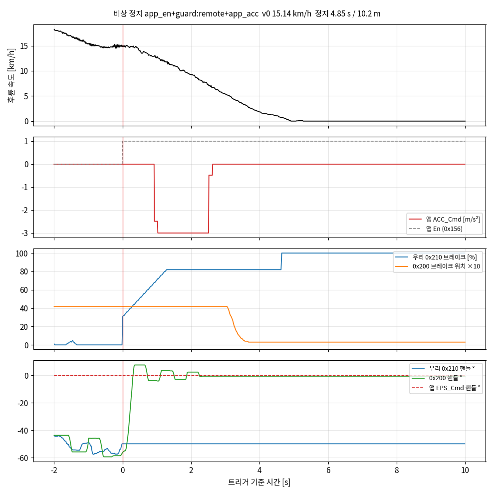

# 참고 — 11-04 자율 주행 중 앱 비상 정지 2건 (00 시험 전 자료, 판정 아님)

만든 날 2026-11-05(개발 PC, 저장된 로그 분석 — CLAUDE.md 1.3). 소프트웨어: 11-04 주행은 A1-BSW `de5f161`(A1_Total 설치본).
원본: `measurements/2026-11-04_drive_log/raw_can/auto_bsw{4,5}/kvaser_ch0.log.zst`(Kvaser ch0, sha256 은 `RAW_SOURCES.md`),
이벤트 `measurements/2026-11-04_drive_log/tables/canguard_events.csv`. 0x201 ÷ 0.958(GNSS 대비, 잠정). 시각은 Kvaser 수신 시각(epoch).

```bash
R=measurements/2026-11-04_drive_log
for s in bsw4 bsw5; do python3 bsw_test/00_SAF_estop/scripts/analysis.py $R/raw_can/auto_$s/kvaser_ch0.log.zst \
  --events $R/tables/canguard_events.csv --session $s --out bsw_test/00_SAF_estop/results/ref_20261104_app_estop --plot --name 20261104_auto_$s; done
```

| 항목 | bsw4 17:00:43 (주행 중) | bsw5 17:10:21 (정지) |
|---|---|---|
| 트리거 | 앱 En(0x156 `01 96 01`) → 0.93 s 뒤 ACC_Cmd ≤ −1 | 앱 En |
| v0 | 15.14 km/h | 0 |
| can_guard 감지 / 첫 ESTOP 송신 | 5.9 / 5.9 ms | 18.6 / 11.8 ms(이미 브레이크 100 유지 중) |
| 앱 En 유지 | 49.99 s | 8.01 s |
| 앱 ACC_Cmd 최소 / ≤ −1 유지 | −3.00 m/s² / 1.59 s | 0.00 / 0 s |
| 감속 시작(0.5 km/h 감소) | 211 ms | — |
| 정지 시간 / 거리 / 평균 감속 | 4.85 s / 10.2 m / 0.87 m/s² | — |
| 휠락 | 없음 | — |
| 0x200 브레이크 위치 상승 | 없음(4.2 유지 → 4 s 에 0.3) — 차량이 우리 0x210 을 무시 | 없음(8.2 → 0.2) |
| t0 −0.1 → +0.5 s 핸들 변화 | +66.1°(−58.5 → +7.6, 앱 EPS_Cmd 0°) | +33.9° |
| 0x200 핸들이 앱을 따름 | 예 | 예 |
| 앱 해제 순간 속도 / 1 s 뒤 핸들 변화 / 우리 브레이크 | 1.51 km/h / **−53.0°** / 100 % | 0 / −14.2° / 0 %(원격 유닛 0x210 이 섞여 무의미) |
| 0x210 송신자 둘 | 아니오 | **예 — 세션 중 124 s**(원격 유닛 47 /s) |
| t0 뒤 auto 000 | 0 | 0 |



해석과 00 기준 재정의는 [`../../docs/goal.md`](../../docs/goal.md) 0절. 감속 구간별: 0–0.93 s(ACC_Cmd 0) ★ 0.61 m/s², 0.93–2.5 s(−3.0) ★ 1.0, 2.5–4.0 s(0) ★ 1.0.
