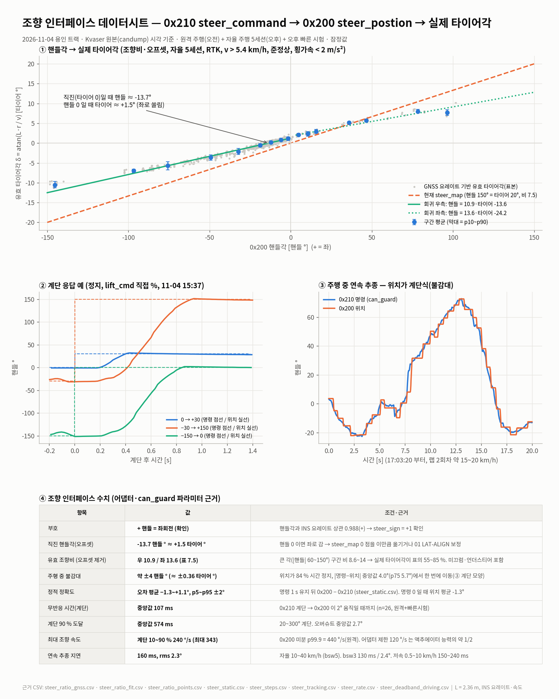
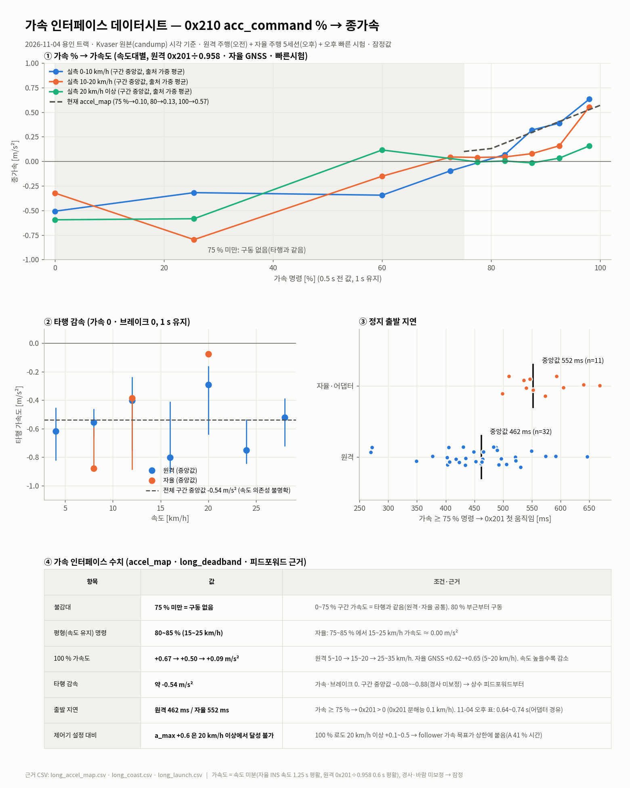
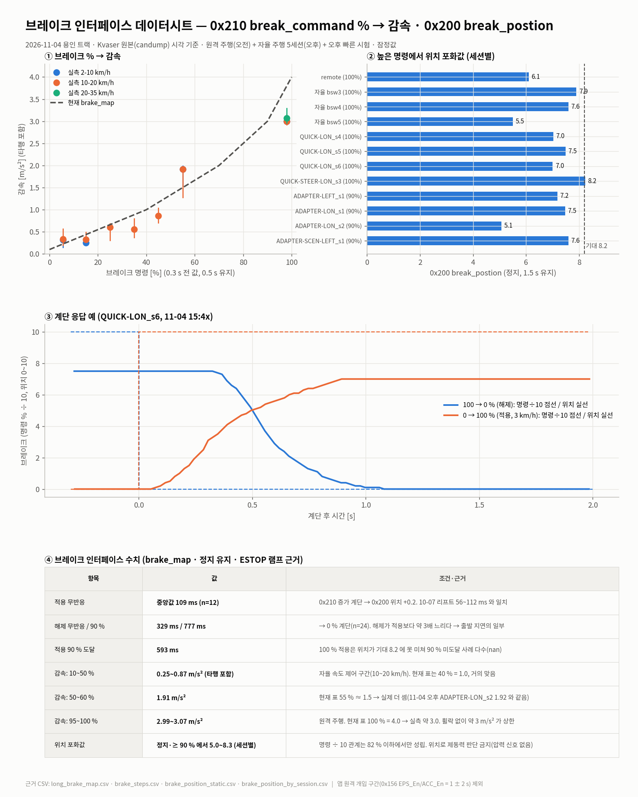
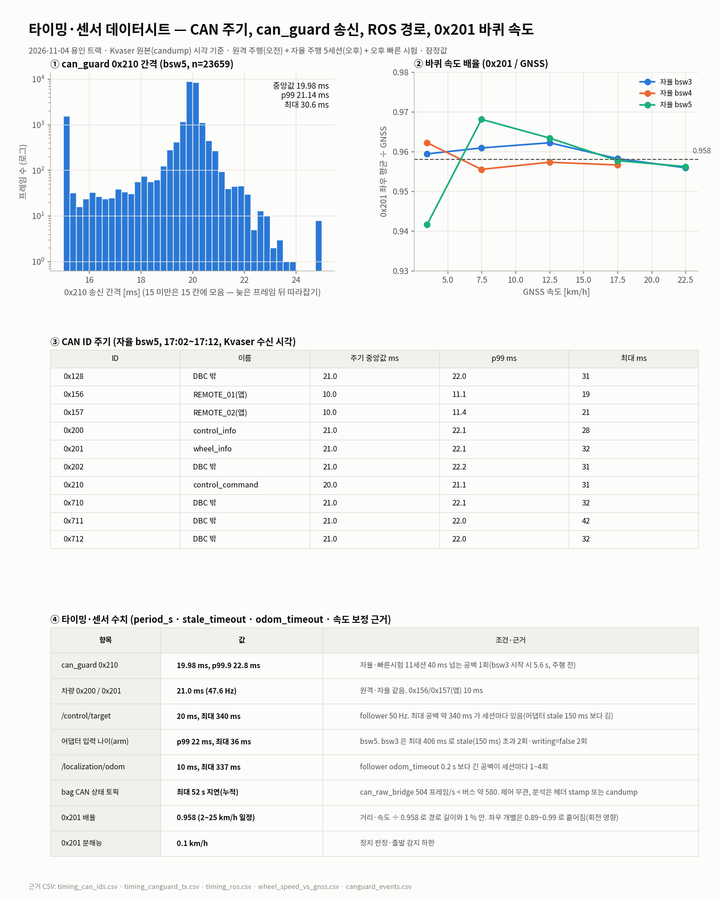

# 2026-11-04 실차 주행 로그 요약 — 1차 원격 주행 · 2차 자율 주행

> 원본이 커서(자율 주행 폴더 52 GB) 원본 대신 **꼭 봐야 할 수치와 해석**만 텍스트로 옮긴 문서다. 작성 2026-11-04 (Claude, 원본 수정 없음).
> 표기: ★ = 로그에서 계산한 값, **잠정** = 1회·조건 제한 값. 핸들각과 타이어각은 `핸들 °` / `타이어 °` 로 구분하고, 타이어각 = 핸들각 ÷ 7.5(잠정 조향비)로 환산했다.
> 이 문서는 판정이 아니다. 합격 판정은 각 테스트 `goal.md` 기준으로 따로 한다.

## 0. 한눈에

| 구분 | 1차: 원격 주행 (오전) | 2차: 자율 주행 (오후) |
|---|---|---|
| 시각 | 11:40:47 ~ 12:12:46 (CAN 기록 32분) | 16:40 ~ 17:12 (세션 `a1drive_20261104_164006_run`) |
| 주행 | 약 2.34 km 주행 2회(사실상 외곽 랩 2바퀴) + 저속 이동, 합계 ★ **4.96 km**, 이동 시간 1006 s | 60 m 1회, 300 m 1회, 외곽 랩(2572 m) 2회 시도 → 랩 2회차에서 ★ **2.0 km 연속 자율 주행** |
| 최고 속도 | ★ 31.6 km/h (30 km/h 넘은 시간 80 s) — 0x201 값, 실제는 약 4 % 높음 | ★ 20.1 km/h (목표 cruise 20 km/h) |
| 핵심 결과 | 실주행 가속·감속 %↔m/s² 분포 확보(TODO-3 재료) | 횡편차 p95 ★ 0.53~0.56 m, 최대 ★ 1.08~1.17 m. **좌측(+)으로 평균 0.29~0.33 m 치우침** |
| 주의할 발견 | 타행(가속 0·브레이크 0) 감속이 ★ −0.4~−0.6 m/s² 로 큼 | ① 앱 비상정지 때 차량이 can_guard가 아니라 **원격 앱 명령을 따름** ② bag 의 CAN 상태 토픽이 **최대 52 s 지연** ③ 가속/제동 명령이 **분당 216회 전환**(떨림) |

---

## 1. 1차 — 원격 주행 (오전)

### 1.1 원본

| 파일 | 크기 | 내용 |
|---|---|---|
| `measurements/2026-11-04_signal_audit/raw/kvaser_ch0_listen.log` (git 밖, sha256 은 같은 폴더 `raw/README.md`) | 48 MB | Kvaser ch0 듣기 전용, 1,113,179 프레임 |
| `~/rosbags/a1_loc_20261104_113808`, `_114432`, `_115541` | 1.9 / 2.9 / 6.8 MB | LiDAR 위치 추정(`/lidar_odometry/*`)만. **GNSS 토픽 0개**(이 시간대에는 GNSS 를 녹화 안 함) |
| 신호 판정표 | — | `measurements/2026-11-04_signal_audit/results.md` (judge.py, ID별 주기·신호 범위·카운터) |

- 원격 유닛이 0x210 을 직접 보냈다(`*_is_auto_command` = 1 고정, 21.2 ms 주기). 0x156 `EPS_En/ACC_En` 은 녹화 내내 0 → 앱 원격 경로는 이번 주행에 안 씀.
- DBC 의 SYS 계열(0x100, 0x110~0x114, 0x301)은 이번에도 안 보임.

### 1.2 주행량·속도 (0x201 후륜 좌우 평균)

| 항목 | 값 |
|---|---|
| 총 이동 거리 | ★ 4,960 m |
| 이동 시간(> 0.5 km/h) | ★ 1,006 s, 이동 중 평균 ★ 17.8 km/h |
| 긴 주행 2회 | 239.5~675.2 s 구간 ★ 2,343 m(최고 31.6) / 1237.2~1624.5 s 구간 ★ 2,337 m(최고 31.5) — 외곽 랩 2572 m 와 비슷 |
| 속도대별 시간 | 10 km/h 초과 762 s / 20 초과 429 s / 25 초과 303 s / 30 초과 80 s |
| 좌우 바퀴 속도 차(> 5 km/h) | 중앙값 ★ −0.3 km/h, |차| p99 2.6 km/h |

### 1.3 가속·감속 (실주행, 명령 % 와 0x201 속도 미분)

> 방법: 속도 0.25 s 이동평균 후 미분. 가속은 명령 0.5 s 뒤, 브레이크는 0.3 s 뒤 반응으로 맞춤. 경사·바람 미보정, GNSS 없음 → **잠정**. 값은 중앙값(p50).

| 가속 명령 (브레이크 0) | 0~10 km/h | 10~20 km/h | 20 km/h 이상 |
|---|---|---|---|
| 0 % (타행) | −0.59 | −0.40 | −0.62 |
| 1~60 % | −0.63 | −0.49 | −0.61 |
| 60~75 % | −0.29 | −0.01 | −0.19 |
| 75~85 % | −0.01 | 0.00 | −0.22 |
| 85~95 % | +0.15 | +0.17 | +0.02 |
| 95~100 % | **+0.62** | **+0.51** | **+0.26** |

| 브레이크 명령 (가속 0, 2 km/h 이상) | 감속 p50 | p10(센 쪽) | 표본 |
|---|---|---|---|
| 1~20 % | −0.60 | −1.92 | 64 |
| 20~40 % | −1.02 | −1.90 | 23 |
| 40~60 % | −1.07 | −2.04 | 17 |
| 60~82 % | −1.03 | −2.30 | 25 |
| 82~100 % | **−2.70** | −3.12 | 505 |

해석:
- **75 % 아래는 사실상 "구동 없음"**, 85 % 부근이 겨우 평형(속도 유지), 100 % 도 속도가 오를수록 가속이 줄어든다(+0.62 → +0.26). 11-04 오후 정지 출발 시험(불감대 70~80 %, 100 % ≈ 0.57 m/s²)과 맞다.
- **타행 감속 −0.4~−0.6 m/s²** 가 크다. 가속을 떼기만 해도 약한 브레이크 수준으로 선다 → 속도 제어기의 피드포워드에 넣어야 한다(지금 `accel_map` 에는 이 항이 없다).
- 브레이크는 원격 운전자가 대부분 100 % 로 써서(브레이크 > 0 인 시간 2.5 %) 중간 구간 표본이 적다. 82 % 이상 ≈ −2.7 m/s².
- 원격 주행 중 0x200 `break_postion` 최대는 6.8 이었다(정지 시험 때는 8.2 포화). 주행 중 브레이크 위치가 덜 올라가는 이유는 확인이 필요하다.
- 최대 가속 ★ +1.26, 최대 감속 ★ −3.37 m/s²(순간값, 노이즈 포함).

### 1.4 조향 (원격 0x210 → 0x200)

| 항목 | 값 |
|---|---|
| 명령 범위 / 위치 범위 | ±150 / −156.4 ~ +154.5 핸들 ° |
| 명령→위치 지연(오차가 가장 작아지는 시간 차) | ★ 360 ms (원격 운전자의 큰 계단 입력이 많아 레이트 제한이 섞인 값) |
| 위치 변화 속도 p99 / 최대 | ★ 376 / 541 핸들 °/s (10-07 리프트 측정 125 °/s 보다 훨씬 빠름 — 주행 중·원격 경로 기준) |

### 1.5 LiDAR 위치 추정 (오전 bag, GNSS 없음)

| bag | 시간 | 주기 | 이동 | 2 m 넘는 점프 | 품질 p5 / p50 |
|---|---|---|---|---|---|
| `113808` | 11:38~11:41 | 10.1 Hz | 299 m | 1 | 0.84 / 0.85 |
| `114432` | 11:44~11:52 | **5.0 Hz** (최대 공백 7.8 s) | 2,113 m | **180** | 0.57 / 0.75 |
| `115541` | 11:55~12:08 | 9.6 Hz | 2,774 m | 59 | 0.82 / 0.90 |

→ 첫 랩(114432)은 LiDAR odometry 가 반 속도로 돌며 점프가 많았고, 두 번째(115541)는 크게 좋아졌다. 오후에는 GNSS + LO 병합(`/localization/odom`)으로 주행했다.

---

## 2. 2차 — 자율 주행 (오후)

### 2.1 원본·구성

| 항목 | 내용 |
|---|---|
| 세션 폴더 | `~/a1_race_capture/a1drive_20261104_164006_run/` (52 GB, zip 15 GB) |
| 큰 bag | `bag_all/`(16:40~16:49, 26 GB), `bag_run300/`(16:57~17:10, 26 GB) — LiDAR 점군 포함 |
| BSW 세션 | `bsw/`~`bsw5/` (각 55~204 MB): candump(Kvaser 원본), can_guard 로그·이벤트, 어댑터·위치·GNSS bag |
| 경로 | `meta/short_racingline_60m.csv`(60.1 m), `racingline_300m.csv`(300 m), `yongin_outer_lap.csv`(2572 m, 닫힌 경로) |
| 소프트웨어 | `~/git/A1_Total` 설치본(BSW = `src/bsw`, 어댑터 표 `track.yaml` 사본은 각 `bsw*/track_params.yaml`). A1-BSW 저장소 기준 커밋 `de5f161` |
| 제어 | waypoint_follower(pure pursuit, lookahead 3 + 0.8·v, 3~10 m) → `/control/target` → a1_control_adapter → can_guard(RT, CPU 8, SCHED_FIFO 90) → 0x210 |
| 속도 설정 | cruise 20 km/h, 횡가속 상한 1.0 m/s²(랩 2회차는 0.6), a_max +0.6 / a_min −3.0 m/s², 속도 PI kp 0.8 · ki 0.2 |
| 안전 설정 | 횡편차 1.0 m 넘으면 정지(랩 2회차 1.5 m), heading 30°, odom 끊김 0.2 s, 앱 비상정지 = 원격 0x156 |
| 위치 | `/localization/odom`(GNSS 100 Hz + LO 보정). GNSS 는 전 구간 **RTK Fixed(4) + IMU ALIGNED(3)**, 수평 RMS 중앙값 ★ 0.018 m |

### 2.2 주행별 결과

| 회차 | 시각 | 경로·구간 | 끝난 이유 | 거리 0x201 (÷0.958 보정) | 최고 / 평균 속도 | 횡편차 평균 · \|p95\| · 최대 |
|---|---|---|---|---|---|---|
| A 짧은 직선 | 16:54:48~16:55:07 (18.7 s) | 60 m, s 0→60 | goal 정상 정지 | 57 m (60 m) | 19.4 / 11.7 km/h | +0.03 · 0.26 · 0.27 m |
| B 300 m | 16:57:07~16:58:12 (64 s) | 300 m, s 0→300 | goal 정상 정지 | 290 m (303 m) | 20.1 / 16.6 | +0.33 · 0.51 · **1.29 m**(정지 중) |
| C 랩 1회차 | 17:00:20~17:00:47 (27.7 s) | 랩 s 377→477 | **앱 비상정지**(17:00:43.1, 14.2 km/h) → 1.5 s 뒤 follower 도 횡편차 정지 | 97 m (101 m) | 18.9 / 13.1 | +0.56 · 0.96 · 1.09 m |
| D 랩 2회차 | 17:02:47~17:09:49 (422 s) | 랩 s 500→2524 | 사람이 disable(정상 종료), 이후 앱 비상정지로 정지 유지 | **1,941 m (2,026 m)** — 경로 s 기준 2,024 m | 20.1 / 16.6 | +0.29 · 0.56 · 1.17 m |

- 거리·속도는 candump(Kvaser 원본) 시각 기준. 0x201 을 ÷0.958(2.4절) 보정하면 경로 길이와 1 % 안에서 맞는다 → 보정 계수 확인됨.
- 횡편차는 `/localization/odom` 과 경로 CSV 로 직접 계산했고, follower 가 보고한 값(`/waypoint_follower/status`)과 맞는다(D: follower \|p95\| 0.56, 최대 1.18).
- B 의 최대 1.29 m 는 **goal 정지 중**(STOPPING, 마지막 2 s, 조향 −15.7°까지 증가)에 생겼다. 추종 중 최대는 0.70 m.
- D 의 최대 1.17 m 는 출발 직후(랩 1회차가 멈춘 자리에서 0.7 m 벗어난 채 출발). 출발 10 s 이후 최대는 ★ **1.08 m, s≈1171 m 헤어핀**(경로 최소 반경 10.3 m, 6.4 km/h, 조향 −19.2 타이어 °로 상한 20° 거의 포화).
- D 구간 나눔: 직선(\|조향\| < 3°) \|p95\| ★ 0.47 m, 곡선(≥ 5°) \|p95\| ★ 0.76 m.
- 200 m 구간별 최대 \|횡편차\|(D): 400:1.17(출발) · 600:0.51 · 800:0.49 · **1000:1.08**(헤어핀) · 1200:0.63 · 1400:0.41 · 1600:0.49 · 1800:0.46 · 2000:0.41 · 2200:0.43 · 2400:0.38 m.

### 2.3 조향 — 치우침과 이득

| 항목 | 값 | 해석 |
|---|---|---|
| 액추에이터 추종(0x210 → 0x200, candump 시각) | 지연 ★ 150 ms, 오차 rms ★ 2.4~2.8 핸들 °, p95 4.6~5.7 핸들 ° | 조향 액추에이터 자체는 명령을 잘 따른다(기울기 1.00, 오프셋 0) |
| 직선에서 명령한 타이어각(경로 요구 ≈ 0°) | 300 m: ★ −1.63°, 랩: ★ −1.79° | 직선을 가려면 **오른쪽 약 1.7 타이어 °(≈ 13 핸들 °)를 계속 줘야 했다** |
| 횡편차 평균 | +0.29 ~ +0.56 m (모든 회차 좌측 +) | 오른쪽 조향을 주고도 왼쪽에 머문다 → pure pursuit 는 적분이 없어 정상상태 오차가 남는다 |
| 곡선: 명령 vs 경로가 요구하는 타이어각(atan(L·κ)) | 우회전 요구 −9.7° → 명령 −17.0° / −5.1° → −9.3°, 좌회전 +5.4° → +6.2° / +8.5° → +11.4°. 회귀 ★ 명령 = 1.52 × 요구 − 1.77° | 명령한 만큼 차가 돌지 않는다 → **조향비 7.5 가 실제보다 작을 가능성**(실제 타이어각 < 핸들 ÷ 7.5) + 좌측 쏠림 |

→ **잠정 결론:** 좌측 쏠림 약 +1.7~1.8 타이어 ° 와 조향 이득 부족(실제 조향비 > 7.5 추정)이 함께 있다. 지금 추종 오차의 대부분(평균 +0.3 m 치우침, 헤어핀 1.08 m)을 설명한다. 부호는 `track.yaml` `steer_sign` = +1 기준(좌 = +).
→ 확인 방법: 01 LAT-ALIGN(직선 50 m 오프셋), 05 LAT-MAXSTEER·06 에커먼(GNSS 요레이트로 실제 타이어각 → 조향비 변환표, TODO-4). 맵/경로의 횡 오프셋이 원인일 가능성도 01 에서 함께 배제해야 한다.

### 2.4 종방향 — 속도 유지와 명령 떨림 (candump 시각)

| 회차 | 가속 % > 0 비율 (중앙값) | 100 % 비율 | 브레이크 > 0 비율 (최대) | 가속·제동·무명령 전환 횟수 |
|---|---|---|---|---|
| A | 0.70 (100) | 0.42 | 0.00 (55) | 16 회 (51/분) |
| B | 0.68 (87) | 0.16 | 0.11 (100) | 137 회 (128/분) |
| D | 0.60 (81) | 0.05 | 0.14 (100) | **1,520 회 (216/분)** |

- 15 km/h 이상 구간 속도는 ★ 16.5~19.6 km/h(p5~p95, D, 0x201 미보정) 로 유지됐다. 직선에서 대체로 19~20 km/h.
- 하지만 **가속 75~100 % ↔ 브레이크 ↔ 0 이 약 0.3 s 마다 바뀐다.** 원인 추정: 가속 맵이 75 % 에서 0.1 m/s² 로 시작해(1.3절: 75 % 아래는 구동 없음) 데드밴드 ±0.1 m/s² 경계에서 켜졌다 꺼졌다 하고, 타행 감속(−0.5 m/s²)이 맵에 없어 제어기가 작은 감속을 브레이크로 풀려 한다. 브레이크·구동계 마모, 승차감, 속도 출렁임(B: 16~20 km/h)의 원인.
- 개선 후보(제안, 미적용): 타행 감속을 피드포워드에 넣기, 작은 감속(< 0.5 m/s²)은 브레이크 대신 가속 0 으로 처리, 가속/브레이크 전환에 히스테리시스·최소 유지 시간.
- 출발: A 에서 0 → 19 km/h 약 8 s (a 목표 +0.6 이 41 % 시간 동안 상한에 붙음 — 가속 능력이 상한 0.6 보다 낮다).
- 0x201 속도는 위치 추정 속도보다 ★ **4.2 % 낮게** 나온다(비율 0.958, 모든 회차 같음). 바퀴 지름 설정값 차이로 보인다 → 0x201 로 거리·속도를 쓸 때 보정 필요(GNSS 우선 원칙 유지). 1장 원격 주행 거리·속도도 같은 비율만큼 낮게 잡혔을 수 있다.

### 2.5 위치 추정

| 항목 | 값 |
|---|---|
| GNSS | 전 회차 RTK Fixed + IMU ALIGNED, 수평 위치 RMS 중앙값 0.018 m(최대 0.060 m), heading RMS 0.04~0.07° |
| `/localization/odom` | 100 Hz, 최대 공백 ★ 345 ms(B), 337 ms(D) — follower odom 타임아웃(0.2 s)보다 길다. 정지로 이어지진 않았지만 원인 확인 필요 |
| LO 품질 | p5 0.83~0.87, 최소 0.79 |
| 병합 결과 − 원시 GNSS (좌표계 상수 차이 제거 후) | p50 0.06~0.18 m, p95 0.44~0.82 m, 최대 ★ 1.05 m |
| 병합 노드 경고(16:53~17:12) | "LO correction jump exceeds the limit" 27회, "re-synced (step)" 9회(0.57~1.00 m 계단 보정) |

→ 위치 추정은 GNSS 기준 cm 급인데, LO 보정이 0.6~1.0 m 계단으로 튈 때가 있다. 횡편차 그래프의 일부 튐은 차가 아니라 위치 추정 계단일 수 있다(병합 경고 시각과 대조 필요).

### 2.6 안전·운용 이벤트

| 시각 | 이벤트 | 내용 |
|---|---|---|
| 16:42~17:02 | can_guard INIT→ACTIVE 5회 | 모든 세션 송신 오류 0건(`tx_fail=0`) |
| **17:00:43.14** | 앱 비상정지(랩 1회차, 14.2 km/h) | 감지 지연 ★ 5.8 ms, ESTOP 첫 송신 즉시(브레이크 30.8 %). 그런데 **차량은 우리 0x210(조향 −49.8, 브레이크 35→82 %)을 따르지 않고 앱 원격 명령을 따랐다**: 조향 위치 −53 → +7.6 °(앱 EPS_Cmd 0)로 0.25 s 만에 돌아감, 브레이크 위치 4.2 → 0.3 으로 오히려 내려감, 감속은 앱 ACC_Cmd −3.0(1.5 s 동안)에 따라 14.5 → 0 km/h 약 5 s(★ 평균 0.8 m/s²) |
| 17:01:33~17:02:19 | 랩 1회차 재시작 시도 | follower 는 TRACKING 이었지만 can_guard 가 ESTOP 래치 상태(브레이크 100 유지)라 차는 움직이지 않음 — 의도대로 동작 |
| 17:09:46 | 랩 2회차 종료 | 사람이 follower disable → 정지. 17:10:21 앱 비상정지(정지 상태, 감지 18.3 ms)로 브레이크 100 유지 |

→ **안전 해석(중요):** 앱 enable(0x156 EPS_En·ACC_En = 1)이 들어오면 차량은 원격 경로를 우선한다. 즉 앱 비상정지의 실제 제동력은 **can_guard ESTOP 브레이크가 아니라 앱이 보내는 ACC_Cmd** 가 결정한다. 이번에는 앱이 −3.0 을 1.5 s 만 보내고 0 으로 돌아가 정지까지 약 5 s 가 걸렸다. 또 조향이 앱 값(0°)으로 바로 돌아가므로 곡선 중 비상정지 시 경로를 벗어날 수 있다. 00 SAF-ESTOP 기준(제동 시작 ≤ 200 ms)과 CLAUDE.md 1.4절 "ESTOP 브레이크 30 → 82 %" 가정을 이 사실에 맞춰 다시 봐야 한다.

### 2.7 기록 문제 — bag 의 CAN 상태 토픽 지연

| 토픽 | 실제 주기 | bag 기록 주기 | 수신시각 − 헤더시각 |
|---|---|---|---|
| `/interface/can/read/raw` (can_raw_bridge) | 버스 약 580 프레임/s | 504 /s | 중앙값 23.7 s, **최대 52.1 s** (bag_run300) |
| `/control/status/control_info` (0x200) | 47.6 Hz | 38.1 Hz | bsw: 최대 4.5 s → bsw3: 36.1 s → **bsw5: 52.3 s** (세션이 길수록 계속 커짐) |
| `/control/status/wheel_info` (0x201) | 47.6 Hz | 26 Hz | 위와 같음 |
| `/localization/odom`, `/control/adapter/status` | 100 / 50 Hz | 같음 | 0.003 s (정상) |

- can_raw_bridge 가 버스 속도를 못 따라가 큐가 쌓인다(일부 손실 포함).
- **제어에는 영향 없음:** follower 는 `/localization/odom` 속도를 쓰고, 어댑터는 이 토픽을 구독하지 않으며, can_guard 는 CAN 을 직접 읽는다(ESTOP 시 차속 14.2 km/h 정확).
- **분석에는 치명적:** `fit_maps.py` 처럼 bag 의 `/control/status/*` 를 bag 시각으로 쓰면 수십 초 어긋난다. 오늘 분석의 조향·속도·명령 수치는 전부 **candump(Kvaser) 시각** 또는 헤더 시각 기준으로 다시 계산했다. 다음부터 bag 분석 시 헤더 stamp 를 써야 하고, 브리지 성능(C++ 화, 필터로 0x200/0x201/0x210 만 발행 등)을 고쳐야 한다.

---

## 3. 다음에 할 일 (제안)

| 순위 | 할 일 | 근거 |
|---|---|---|
| 1 | 앱 비상정지 동작 재정의: 원격 우선권을 전제로 앱 측 ACC_Cmd 를 −3 으로 유지하는지, 우리 ESTOP 이 의미가 있는지 업체·대회측 확인. 00 SAF-ESTOP 절차·기준 갱신 | 2.6 |
| 2 | 조향 보정: `steer_map` 을 5.1절 측정 대응점으로 다시 잡기(오프셋 −13.7 핸들 °, 유효 조향비 우 10.9 / 좌 13.6). 01 LAT-ALIGN·05/06 으로 확정 | 2.3, 5.1 |
| 3 | 종방향: `accel_map` 을 속도별 2차원 표로, 타행 감속(약 −0.5 m/s²) 피드포워드, 가속/브레이크 전환 히스테리시스 → 분당 216회 떨림 제거 | 1.3, 2.4, 5.2 |
| 4 | can_raw_bridge 지연 수정, bag 분석 도구는 헤더 stamp 사용 | 2.7 |
| 5 | 0x201 속도 4.2 % 낮음 — 보정 계수 0.958(2~25 km/h 일정) 적용 또는 바퀴 지름 설정 확인 | 2.4, 5.4 |
| 6 | 병합 위치 추정의 LO 계단(0.6~1.0 m)·odom 공백(> 0.3 s) 원인 확인(localization 팀 전달) | 2.5 |
| 7 | `brake_map` 100 % 를 4.0 → 약 3.0 m/s² 로, 브레이크 위치(0x200)는 피드백으로 쓰지 않기(정지 100 % 포화값이 세션마다 5.0~8.3) | 1.3, 5.3 |

## 4. 계산 방법 메모

- CAN 디코딩: `tools/signal_audit/dbc_lite.py` + `DBC/A1_dbc_fixed.dbc`, 원격 0x156/0x157 은 `dbc_lite.remote_messages()`.
- bag 읽기: rosbag2_py(`A1_Total/install` 메시지 정의). 횡편차는 경로 폴리라인까지 부호 있는 거리(좌 +), 닫힌 경로는 끝-시작 연결.
- 경로 요구 타이어각 = atan(2.36 m × 곡률), 곡률은 경로점 9개 평균.
- 스크립트·표·그림은 [`2026-11-04_drive_log_data/`](2026-11-04_drive_log_data/) 에 있다(5장 끝 "데이터 파일" 참고).

---

## 5. 인터페이스 세부 수치 (어댑터 `track.yaml`·can_guard·follower 파라미터 근거)

> 원본: 오늘 Kvaser 원본 로그 전부. 오전 원격 1개, 오후 자율 5세션(`bsw`~`bsw5`), 오후 빠른 시험 9세션(`20261104_QUICK-*`, `ADAPTER-*`). 자율 세션은 GNSS(INS) bag 도 함께 썼다.
> 시각은 전부 Kvaser 수신 시각이다(bag 의 `/control/status/*` 는 지연이 있어 안 씀, 2.7절). 앱 원격이 켜진 시간(0x156 `EPS_En`/`ACC_En` = 1, 앞뒤 2 s)은 뺐다. 이때 차량은 0x210 이 아니라 원격을 따르기 때문이다.
> 모든 값은 **잠정**이다. 아래 "제안"은 근거 정리일 뿐이고, `track.yaml` 에는 아직 반영하지 않았다(바꾸려면 사용자 승인이 필요하다, CLAUDE.md 1.2).

### 5.0 파라미터 대조표 — 현재 값 vs 11-04 실측

| 파라미터 (파일) | 현재 값 | 11-04 실측 ★ | 해석 · 제안(미적용) |
|---|---|---|---|
| `steer_sign` (track.yaml) | +1 | 핸들각과 INS 요레이트의 상관 **+0.988** | **+ = 좌회전 확인.** 그대로 둔다. 이제 "부호 미확인" 표시를 뗄 수 있다 |
| `steer_map` 0 점 | 타이어 0 = 핸들 0 | 차가 직진할 때 핸들 **−13.7°**. 핸들 0 이면 타이어 **+1.5°**(좌) | 0 점을 핸들 −13.7° 로 옮기거나 01 LAT-ALIGN 에서 확정한다. 2.3절의 "직선에서 −1.7 타이어 °" 와 같은 현상이다 |
| `steer_map` 기울기 | 7.5 핸들 °/타이어 ° (150 ↔ 20) | 유효 조향비 우 **10.9**, 좌 **13.6**. 큰 각에서 8.6~14 | 실제로 도는 양이 표의 55~85 %. 표를 측정 대응점(5.1절)으로 바꾼다. 미끄럼·언더스티어가 섞인 "유효" 값이다 |
| follower `max_steer_tire_deg` | 20 | 핸들 150° 에서 유효 타이어각 약 **−10.6°(우)**. 좌는 +8°(핸들 96°)까지만 측정 | 20° 를 명령해도 실제로는 약 11° 이하다. 헤어핀(필요 11.7°)에서 포화된 원인 |
| `steer_rate_limit_deg_s` | 120 | 액추에이터 계단 10~90 % **240 °/s**(최대 343). 0x200 미분 p99.9 440 °/s | 120 은 능력의 약 절반이라 보수적이다. 올리려면 07 프로파일 시험 뒤에 |
| (불감대, 표 없음) | 10-07 리프트 ±1.5° | 주행 중 위치가 **84 %** 시간 멈춰 있다. \|명령−위치\| **4.0°**(p50, p75 5.7°)에서 한 번에 움직임 | 약 ±4 핸들 ° ≈ ±0.3~0.4 타이어 °. 01 기준(50 m 0.125 m)에 영향 → 불감대 보상이나 디더 검토 |
| 조향 지연 (follower 모델) | 무반응 175 ms(10-07) | 계단 무반응 **107 ms**, 90 % 도달 **574 ms**. 연속 추종 **130~160 ms**(10~40 km/h) | follower 지연 보상값으로 150 ms 부근 |
| `long_deadband_mps2` | 0.1 | 가속·브레이크·0 전환이 **분당 216회**(랩 2회차) | 데드밴드만으로는 부족하다. 가속↔제동 히스테리시스와 최소 유지 시간 |
| `accel_map` | 0.10/0.13/0.57 m/s² ↔ 75/80/100 % | 75 % 미만은 구동 없음. 평형(가속 0)은 15~25 km/h 에서 **80~85 %**. 100 % 는 **+0.67(5~10) → +0.50(15~20) → +0.09(25~35 km/h)** | 속도에 따라 크게 다르다 → **속도 × % 2차원 표**와 타행 피드포워드(5.2절). 20 km/h 이상에서는 +0.6 m/s² 를 낼 수 없다 |
| follower `a_max_mps2` | +0.6 | 위와 같음 | 20 km/h 이상이면 +0.3 이하로 잡는 것이 현실적이다(상한에 붙어 적분이 쌓임) |
| (타행 감속, 표 없음) | 없음 | 가속 0·브레이크 0 에서 **약 −0.54 m/s²**(구간 중앙값 −0.08~−0.88) | 작은 감속(< 0.5)은 브레이크 대신 가속 0 으로 처리한다 → 떨림이 줄어든다 |
| `brake_map` | 0.1/1.0/2.0/3.0/4.0 m/s² ↔ 0/40/70/90/100 % | 10~50 % → **0.25~0.87**, 50~60 % → **1.91**, 95~100 % → **2.99~3.07 m/s²** (타행 포함 전체 감속) | 40 % 점은 거의 맞다. 55 % 는 표보다 세고, 100 % 는 4.0 → **약 3.0**. 60~95 % 는 데이터가 없다(다음 시험) |
| follower `hold_decel_mps2` | 4.0 (= 브레이크 100 %) | 100 % 실측 약 3.0 | 표의 100 % 만 고치면 따라온다 |
| 브레이크 지연 | 56~112 ms(10-07 리프트) | 적용 무반응 **109 ms**, 90 % **593 ms**. 해제 무반응 **329 ms**, 90 % **777 ms** | 해제가 적용보다 약 3배 느리다. 출발 지연(아래)의 일부 |
| 출발 지연 | 0.64~0.74 s(11-04 오후) | 가속 ≥ 75 % → 0x201 첫 움직임: 원격 **462 ms**(n=32), 자율·어댑터 **552 ms**(n=11) | 브레이크 해제 지연이 포함된 값 |
| 브레이크 위치 피드백 | 명령 ÷ 10, 82 % 이상 8.2 | 82 % 이하는 명령 ÷ 10 이 맞다(55 % → 5.4). **정지 100 % 포화는 세션마다 5.0~8.3** | 위치로 제동력을 판단하면 안 된다. ESTOP·정지 유지 확인은 차속으로 한다 |
| `period_s` / can_guard 주기 | 0.02 s | 0x210 간격 중앙값 **19.98 ms**, p99.9 22.8 ms. 자율·빠른 시험 11세션에서 40 ms 넘는 공백 1회(bsw3 시작 때 5.6 s, 주행 전) | 정상 |
| `stale_timeout_s` (어댑터) | 0.15 | `/control/target` 최대 공백 **약 340 ms**가 세션마다 1~4회. bsw3 에서 입력 나이 406 ms 로 stale 2회, writing=false 2회 | follower 쪽 멈칫 원인 확인(같은 시각에 odom 공백 337~348 ms) → 위치 추정 쪽 공백이 그대로 전달된 것으로 보인다 |
| follower `odom_timeout_s` | 0.2 | `/localization/odom` 최대 공백 **336~348 ms**(세션마다 1~4회) | 0.2 s 를 넘는데도 이번에는 정지로 이어지지 않았다. 원인 확인 전에는 값을 늘리지 않는다 |
| 0x201 속도 배율 | 1.0(보정 없음) | ÷ GNSS = **0.958**(2~25 km/h 일정) | 속도·거리 ÷ 0.958. 좌우 개별 값은 0.89~0.99 로 흩어진다(회전 영향) |

### 5.1 조향 데이터시트

측정 대응점(핸들 ↔ 유효 타이어각, `steer_ratio_gnss.csv`, 구간 평균):

| 핸들 ° | −145.3 | −96.9 | −75.9 | −49.2 | −32.4 | −18.9 | −12.2 | −6.1 | −1.5 | +4.9 | +10.5 | +15.7 | +36.0 | +46.7 | +78.3 | +96.5 |
|---|---|---|---|---|---|---|---|---|---|---|---|---|---|---|---|---|
| 타이어 ° | −10.57 | −6.94 | −5.72 | −3.58 | −2.11 | −0.56 | +0.19 | +0.83 | +1.22 | +2.09 | +2.40 | +2.89 | +5.18 | +5.67 | +7.99 | +7.68 |
| 표본 | 114 | 110 | 748 | 644 | 726 | 2971 | 4315 | 1675 | 240 | 60 | 67 | 163 | 35 | 181 | 88 | 106 |
| 속도 km/h | 6.7 | 8.4 | 9.8 | 13.5 | 15.9 | 19.3 | 19.4 | 19.7 | 18.9 | 18.9 | 19.8 | 19.1 | 14.1 | 12.8 | 9.0 | 6.9 |

- 측정 방법: 유효 타이어각 δ = atan(L·r / v). L = 2.36 m, r = INS 요레이트, v = INS 속도이고 RTK fix, v > 5.4 km/h, 횡가속 < 2 m/s² 구간만 썼다. 조향 위치는 0.15 s 앞 값을 쓰고, 1 s 동안 핸들 변화 6° 이하이고 요가속 < 5 °/s² 인 준정상 구간만 남겼다.
- 좌회전 쪽(+)은 표본이 적다(700 개, 우 11,303 개). 핸들 +96° 가 +78° 보다 타이어각이 작게 나온 것은 저속(6.9 km/h)·표본 부족 때문으로 보인다. 05 LAT-MAXSTEER(좌·우 최대각, 저속)로 다시 잰다.
- 정적 정확도(`steer_static.csv`): 명령을 1 s 유지한 뒤 위치 오차 평균은 −1.3~+1.1°, p5~p95 ±2° 이다. 명령 0 일 때 위치 평균은 −1.3° 이다.

### 5.2 가속 데이터시트

속도별 가속 % → 가속도 (m/s², 구간 중앙값, `long_accel_map.csv` 에서 출처 가중 평균):

| 가속 % | 0~10 km/h | 10~20 km/h | 20 km/h 이상 |
|---|---|---|---|
| 0 (타행) | −0.51 | −0.32 | −0.59 |
| 70~75 | −0.10 | +0.04 | — |
| 75~80 | — | +0.04 | −0.01 |
| 80~85 | +0.07 | +0.04 | +0.00 |
| 85~90 | +0.32 | +0.08 | −0.02 |
| 90~95 | +0.39 | +0.16 | +0.03 |
| 95~100 | **+0.63** | **+0.55** | **+0.16** |

- 원천: 원격은 0x201 ÷ 0.958 의 미분, 자율은 INS 속도의 미분, 빠른 시험은 0x201 이다. 명령은 0.5 s 전 값이고 그 전 1 s 동안 ±3 % 안에서 유지된 구간만 썼다. 경사는 보정하지 않았다(트랙 구간이 섞여 있음).
- 20 km/h 이상 100 % 의 +0.16 은 원격 25~35 km/h(+0.09)와 자율 20~25 km/h 가 섞인 값이다. 속도가 오를수록 구동력이 빠르게 준다.

### 5.3 브레이크 데이터시트

- 브레이크 % → 감속(m/s², 타행 포함, `long_brake_map.csv` "all"): 1~10 % 0.32~0.34 · 10~20 % 0.25~0.33 · 20~30 % 0.60 · 30~40 % 0.56 · 40~50 % 0.87 · 50~60 % 1.91 · 95~100 % 2.99~3.07.
- 60~95 % 는 깨끗한 표본이 없다. 원격 운전자는 대부분 100 % 만 썼고, 자율은 55 % 다음이 100 %(정지 유지)였다. → 04 LON-DEC 개루프 계단에서 60/70/80/90 % 를 직접 잰다.
- 정지 상태에서 높은 명령을 줬을 때 위치(`brake_position_by_session.csv`): 100 % → 원격 6.1, 자율 bsw3 7.9 / bsw4 7.6 / bsw5 5.5, 빠른 시험 7.0~8.2. 90 % → 5.1~7.6.

### 5.4 타이밍·센서 데이터시트

- can_guard 0x210 간격 히스토그램의 15 ms 칸(약 1,500 프레임)은 늦게 나간 프레임 뒤에 바로 이어서 보낸 프레임이다. 평균 주기는 20 ms 를 지킨다.
- 차량 0x200/0x201/0x202/0x128/0x710~0x712 는 모두 21.0 ms 이고, 앱 0x156/0x157 은 10 ms 이다.

### 5.5 데이터 파일

폴더: [`2026-11-04_drive_log_data/`](2026-11-04_drive_log_data/) (1.7 MB). 모든 CSV 머리말(`#`)에 조건이 적혀 있다.

| 파일 | 내용 |
|---|---|
| `sheets/sheet1_steer.png` ~ `sheet4_timing.png` | 데이터시트 그림 4장(위) |
| `tables/steer_ratio_gnss.csv`, `steer_ratio_fit.csv`, `steer_ratio_points.csv` | 핸들 → 유효 타이어각 구간표·회귀·표본점 |
| `tables/steer_static.csv`, `steer_steps.csv`, `steer_tracking.csv`, `steer_rate.csv`, `steer_deadband_driving.csv` | 조향 정적 오차·계단 응답(34건)·연속 추종 지연·조향 속도·주행 중 불감대 |
| `tables/long_accel_map.csv`, `long_coast.csv`, `long_launch.csv` | 가속 % × 속도 → 가속도, 타행 감속, 정지 출발 지연(43건) |
| `tables/long_brake_map.csv`, `brake_steps.csv`, `brake_position_static.csv`, `brake_position_by_session.csv` | 브레이크 % → 감속, 계단 응답(39건), 위치 정적값 |
| `tables/timing_can_ids.csv`, `timing_canguard_tx.csv`, `timing_ros.csv`, `wheel_speed_vs_gnss.csv`, `canguard_events.csv` | CAN ID 주기, can_guard 송신 간격, ROS 토픽 주기·어댑터 입력 나이, 0x201 배율, can_guard 이벤트 원문 |
| `scripts/` | `extract.py`(bag → CSV, A1_Total 메시지 정의 필요), `hdr.py`(bag 헤더 지연), `iface.py`(5장 표), `sheets.py`(그림), `remote.py`·`auto.py`·`autocan.py`(1~2장 수치), `minidf.py`(pandas 대용) |

다시 만들기: `extract.py` 로 각 `bsw*/bag` 에서 `out/<세션>/` CSV 를 뽑은 뒤 `python3 iface.py tables` → `python3 sheets.py tables sheets` 순서로 돌린다. 스크립트 안의 원본 경로는 대회 차량 PC 기준(`~/a1_race_capture/...`)이다.
