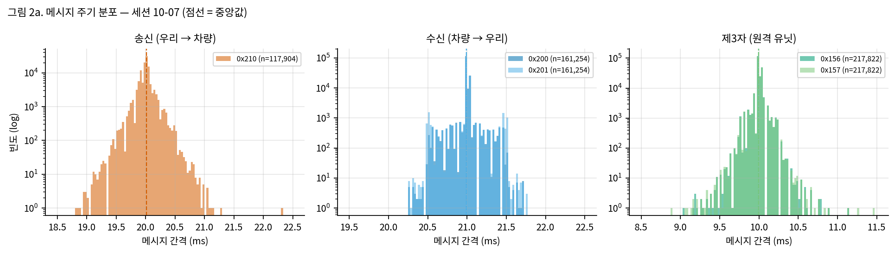
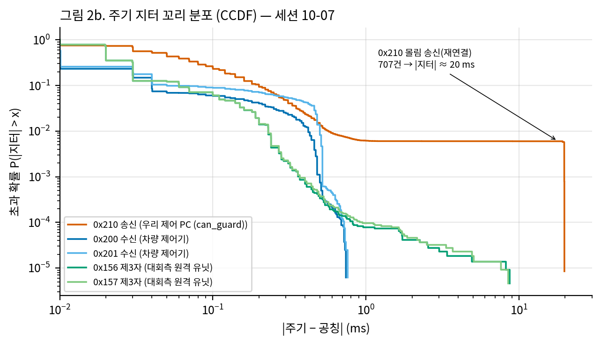
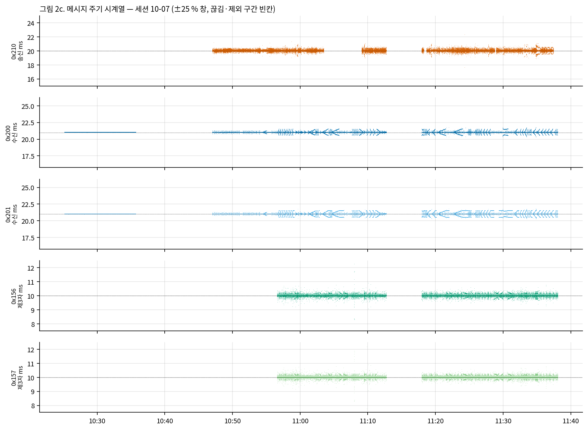
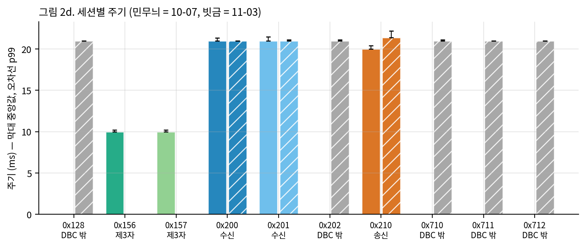
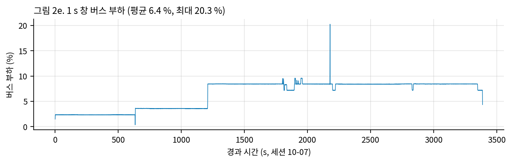

# 표 3. CAN 메시지 주기 — 송신 / 수신 분리

> 생성: `tools/paper_data/bus_stats.py`. 500 kbit/s classic CAN, Kvaser Leaf v3 장치 타임스탬프. 간격 > 500 ms 는 버스 끊김으로 보고 통계에서 제외(끊김 수 따로). 지터 = 실측 주기 − 공칭 주기. 공칭 = 송신 측 설정값(0x210 can_guard 20 ms, 원격 10 ms) 또는 실측 중앙값에 가까운 정수(차량 21 ms).

**역할 구분**: DBC 에 송수신 노드가 없어(모두 `Vector__XXX`) 실측 송신자로 구분 — 송신 = 우리 제어 PC(0x210), 수신 = 차량 제어기(0x200·0x201), 제3자 = 대회측 원격 유닛(0x156·0x157).

## 1. 세션 10-07 — 원본 직접 계산

| 구분 | ID | 이름 | 송신 주체 | 간격 수 | 공칭 ms | 평균 ms | 표준편차 ms | 최소 | p1 | 중앙값 | p99 | p99.9 | 최대 | 공칭 ±5 % 안 | 끊김 | 제외 |
|---|---|---|---|---|---|---|---|---|---|---|---|---|---|---|---|---|
| **송신** | 0x210 | USER_control_command | 우리 제어 PC (can_guard) | 117,904 | 20 | 19.881 | 1.529 | 0.21 | 19.50 | 20.01 | 20.40 | 20.69 | 22.31 | 99.38 % | 5 | 14541 |
| **수신** | 0x200 | USER_control_info | 차량 제어기 | 161,254 | 21 | 20.999 | 0.077 | 20.26 | 20.65 | 20.99 | 21.34 | 21.47 | 21.72 | 100.00 % | 2 | 0 |
| **수신** | 0x201 | USER_right_wheel_info | 차량 제어기 | 161,254 | 21 | 20.999 | 0.114 | 20.26 | 20.52 | 20.99 | 21.47 | 21.51 | 21.76 | 100.00 % | 2 | 0 |
| **제3자** | 0x156 | REMOTE_Control_01 | 대회측 원격 유닛 | 217,822 | 10 | 10.000 | 0.063 | 1.79 | 9.81 | 9.99 | 10.20 | 10.29 | 18.69 | 99.97 % | 1 | 0 |
| **제3자** | 0x157 | REMOTE_Control_02 | 대회측 원격 유닛 | 217,822 | 10 | 10.000 | 0.064 | 1.50 | 9.81 | 9.99 | 10.20 | 10.29 | 17.62 | 99.96 % | 1 | 0 |

- 제외: 0x210 14,541간격 — 미확인 0x210 송신자가 같이 송신한 구간(11:03:30~11:09:05, `measurements/2026-10-07_vehicle_lift/analysis_report.md`).
- 공칭의 절반 미만 간격(몰림·재전송): 0x156 1건, 0x157 1건, 0x210 707건 — 최소값이 0 에 가까운 원인. 10-07 재연결 때 0x210 715개 몰림(analysis_report §2-1).

### 버스 부하 (세션 10-07, 실제 데이터로 비트 스터핑·CRC 계산)

| 항목 | 값 |
|---|---|
| 1 s 창 평균 부하 | 6.42 % |
| 1 s 창 p99 / 최대 | 8.49 % / 20.26 % |
| 스터프 비트 비율 | 9.16 % |
| 0x156 프레임 길이 평균 / 최대 · 정상 부하 기여 | 121.7 / 124 bit · 2.44 % |
| 0x157 프레임 길이 평균 / 최대 · 정상 부하 기여 | 122.0 / 124 bit · 2.44 % |
| 0x200 프레임 길이 평균 / 최대 · 정상 부하 기여 | 120.4 / 128 bit · 1.15 % |
| 0x201 프레임 길이 평균 / 최대 · 정상 부하 기여 | 123.0 / 127 bit · 1.17 % |
| 0x210 프레임 길이 평균 / 최대 · 정상 부하 기여 | 124.6 / 128 bit · 1.25 % |

## 2. 세션 11-03 — 요약값 (원본 저장소 밖, `measurements/2026-11-03_signal_audit/results.md`)

| 구분 | ID | 개수 | 주기 중앙값 ms | p99 ms | 최대 공백 s |
|---|---|---|---|---|---|
| 기타 (DBC 밖) | 0x128 | 54,177 | 21.0 | 21.0 | 595.0 |
| 수신 | 0x200 | 70,533 | 21.0 | 21.0 | 593.4 |
| 수신 | 0x201 | 53,423 | 21.0 | 21.1 | 595.0 |
| 기타 (DBC 밖) | 0x202 | 53,503 | 21.0 | 21.1 | 595.0 |
| 송신* (원격 유닛) | 0x210 | 50,850 | 21.4 | 22.2 | 611.8 |
| 기타 (DBC 밖) | 0x710 | 53,429 | 21.0 | 21.1 | 595.0 |
| 기타 (DBC 밖) | 0x711 | 53,359 | 21.0 | 21.0 | 595.0 |
| 기타 (DBC 밖) | 0x712 | 53,357 | 21.0 | 21.0 | 595.0 |

\* 11-03 녹화 구간(15:56~16:33)의 0x210 은 **원격 유닛이 직접 송신**(0x156/0x157 아님, `measurements/2026-11-03_signal_audit/README.md`). 우리 can_guard 0x210 은 2단계(21:41~, `raw/l4g`·`l4h`) 원본이 필요 — HANDOFF 참조.

## 3. 그림

*그림 2a. 송신·수신·제3자 메시지 주기 분포 (세션 10-07)*

*그림 2b. 공칭 주기 대비 지터의 초과 확률 (송신 = 주황, 수신 = 파랑, 원격 = 초록)*

*그림 2c. 시간에 따른 메시지 주기 (공칭 점선)*

*그림 2d. 세션별 ID 주기 중앙값·p99 (11-03 의 0x210 송신자는 원격 유닛)*

*그림 2e. 실제 프레임(스터핑 포함)으로 계산한 버스 부하*

## 4. 해석 메모 (논문 본문용 초안)

- 차량 상태(0x200·0x201)의 실제 주기는 **21 ms(≈47.6 Hz)** 로 문서상 20 ms 와 다르다. 제어기가 보는 상태 나이는 최대 약 22 ms.
- 우리 송신 0x210 은 비격리·비RT 조건(10-07)에서도 공칭 20 ms 에 대해 p99.9 가 1 ms 안. 대회 운용 설정(격리 코어·FIFO) 값은 미측정.
- 버스 부하는 10 % 안팎으로 여유가 크다 → 병목은 버스가 아니라 액추에이터 무반응 시간(조향 ≈ 0.2 s, 04 데이터시트).