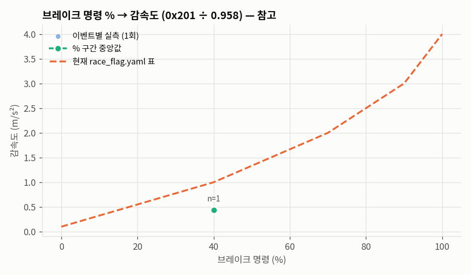
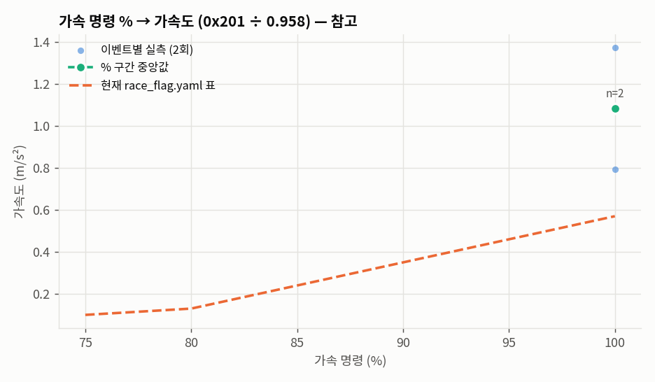
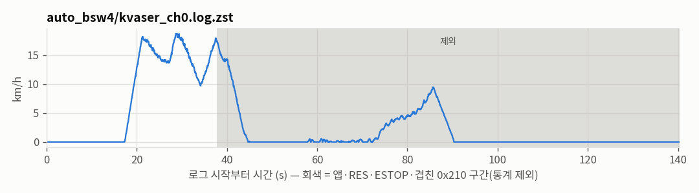

# 가감속 프로파일 추천 — 2026-11-06

**⛔ 갱신 중단 — 아래 값은 참고용, 반영 금지**

커밋 `2f1fe3c` · 도구 `tools/race_flag/fit_long_profiles.py` · 기존 값 `safety/can_guard/race_flag.yaml` (읽기 전용)

## 입력

| 로그 | 프레임 | 길이 s | 시작 unix |
|---|---|---|---|
| auto_bsw4/kvaser_ch0.log.zst | 80785 | 140 | 1793779203.4 |

## 검사(계획서 7.2)

| 검사 | 결과 | CAN 만으로 판정 | 내용 |
|---|---|---|---|
| GNSS 품질 | 확인 불가 | 불가 | GNSS 입력 없음(--bag/--gnss-csv 미지정) |
| 다른 조작 섞임(앱·RES·0x210 송신자) | 걸림 | 가능 | 1개 구간 |
| 다른 조작 섞임(ESTOP) | 걸림 | 불가 | 2개 구간 |
| 물리 한계 | 통과 | 가능 | 후륜 0x201(GNSS 없음) 최대 가속 1.58 m/s² (기준 ≤ 1.6), 최대 감속 0.67 m/s² (기준 ≤ 4.5) |
| 센서 불일치 | 확인 불가 | 불가 | GNSS 없음 — 휠속과 비교할 수 없음 |
| 시간 어긋남 | 확인 불가 | 불가 | GNSS 없음 — CAN 로그와 bag 의 시각 차이를 확인할 수 없음 |
| 표본 부족 | 걸림 | 가능 | 8개 구간이 3 이벤트 미만 |
| 경사 | 확인 불가 | 불가 | GNSS 입력 없음(--bag/--gnss-csv 미지정) |
| 급변 | 통과 | 가능 | 모든 추천값 변화 ≤ 20 % |

## 추천값 (참고)

| 항목 | 기존 | 추천 | 변화 | 근거 |
|---|---|---|---|---|
| a_slow (m/s²) | 2.00 | — | — | 잠기지 않은 구간 중 표본이 충분한 곳이 없음 |
| slow_off_ramp_pct_s (%/s) | 50.0 | — | — | 슬립 10 % 이하가 표본 3회 이상 확인된 상승률 구간이 없음 |

잠김 시작: — % · 휠스핀 시작: — %

```yaml
# 추천 표 (참고) — 사람이 승인한 뒤에만 race_flag.yaml 에 옮긴다
brake_map: {"decel_mps2": [0.1], "brake_pct": [0.0]}
accel_map: {"accel_mps2": [], "acc_pct": []}
```

## 브레이크 % → 감속도 (참고)

| 구간 % | 이벤트 | 중앙 % | 감속 m/s² p50 | p25 | p75 |
|---|---|---|---|---|---|
| 1~20 | 0 | — | — | — | — |
| 20~40 | 0 | — | — | — | — |
| 40~60 | 1 | 40 | 0.44 | 0.44 | 0.44 |
| 60~82 | 0 | — | — | — | — |
| 82~101 | 0 | — | — | — | — |

## 가속 % → 가속도 (참고)

| 구간 % | 이벤트 | 중앙 % | 가속 m/s² p50 | p25 | p75 |
|---|---|---|---|---|---|
| 75~85 | 0 | — | — | — | — |
| 85~95 | 0 | — | — | — | — |
| 95~101 | 2 | 100 | 1.08 | 0.94 | 1.23 |

## 가속 상승률 → 슬립

| 상승률 %/s | 이벤트 | 슬립을 잰 이벤트 | 최대 슬립 % |
|---|---|---|---|
| 0~25 | 0 | 0 | — |
| 25~50 | 0 | 0 | — |
| 50~100 | 0 | 0 | — |
| 100~200 | 0 | 0 | — |
| 200~계단 | 1 | 0 | — |

## 그 밖의 값

- 이벤트 수: 브레이크 1, 가속 2, 가속 상승 1 (`segments.csv`)
- 브레이크 지연(명령 계단 → 0x200 위치 +2 %): 표본 없음
- 0x201 ÷ GNSS 정속 비율: 측정 불가(GNSS 없음), 가감속 계산에 11-04 값 0.958 사용
- 시간 차(후륜 대 GNSS): —

## 서행 단계(계획서 6.3)

도구 판정 단계 **1** (승인 전까지 yaml·CLI 는 그대로) · 서행 구간 0회 · 흔들림 p99.9 최대 — km/h · 휠-GNSS 차이 측정 불가

## 근거 그래프






