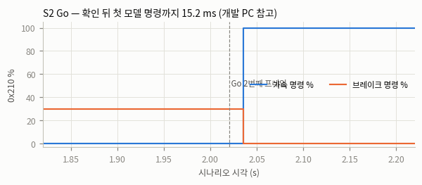
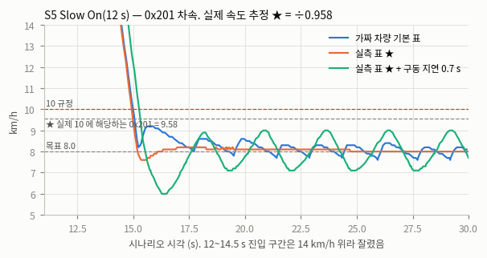
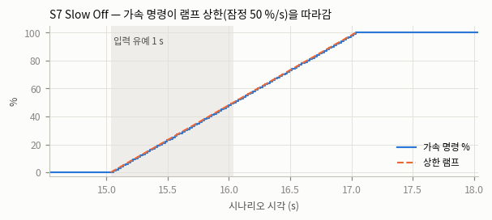
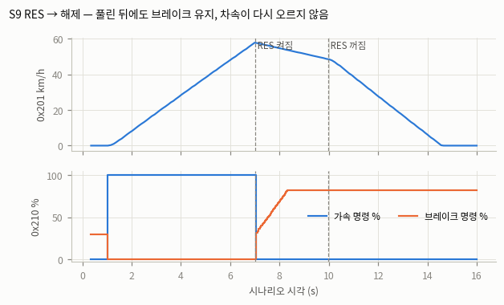
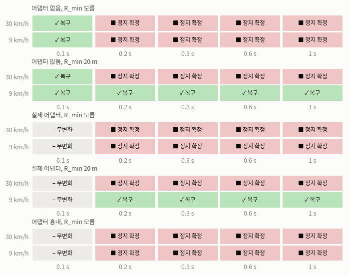

# 경기 깃발 SIL — S1~S18 자동 판정 (2026-11-06)

**개발 PC 참고 결과다. 판정은 대회 PC(`--interface socketcan --channel vcan0`)로 다시 한다**(CLAUDE.md). 지연 값은 로직 확인용이다.

도구 `safety/can_guard/sil_tests/r_race.py`, 시나리오 `sil/vcan/race_scenarios/`, 기준 `docs/2026-11-06_race_flag_dev_plan.md` 11절 WP7 표(숫자 그대로). 판정 근거는 버스의 0x210·0x203·0x202 프레임과 can_guard 이벤트 로그다.
시험 코드 커밋 `647f2bf` · 모드 virtual(같은 프로세스) + 실제 cmd_adapter·race_state_publisher · 라운드 3회.

## 결과 요약

- 전체 86/86 통과(1회차 기준).
- 3회 반복 일치: 전부 같음. 회차별 값은 [rounds.csv](rounds.csv).
- 실행 시간: 회차당 369, 369, 369 s, 전체 18.5 분(모델 직결은 동시 4개, ROS 는 하나씩).

## 전체 표

| ID | 시나리오 | 기준(계획서 WP7 표) | 측정값 | 판정 | 모드 | 커밋 | 비고 |
|---|---|---|---|---|---|---|---|
| S01 | Go 전 모델이 최대 가속을 냄 | 0x210 가속 0, 차속 0, 래치 없음 | auto 111 외 프레임 0회 · 0x210 수 284 · 0x210 가속 최대 0 % · 브레이크(잠정 30 %) 30~30 % · 차속 최대 0.0 km/h · STOPPED·ESTOP 0회 · 경기 상태 전이 0회 | **PASS** | virtual(같은 프로세스) | 647f2bf | 개발 PC 참고 |
| S02 | Go | Go 확인 후 다음 주기에 모델 명령 전달 | auto 111 외 프레임 0회 · 0x210 수 284 · Go 2프레임 버스 확인 · Go 전 가속 최대 0 % · 모델 명령 전달 · Go 확인 뒤 지나간 0x210 0프레임 · 지연(개발 PC 참고) 15.2 ms · race_phase | **PASS** | virtual(같은 프로세스) | 647f2bf | 개발 PC 참고 |
| S02b | 시작부터 Go 켜짐(A1), 0 뒤 상승만 | 0 을 본 뒤의 상승에서만 RACING(브리프 A1) | auto 111 외 프레임 0회 · 0x210 수 384 · go_level_at_start 기록 · 5 s 전(옛 Go 중) 가속 최대 0 % · RACING 시각(0 뒤 상승 5 s) 5.036 s · Go 뒤 모델 전달 | **PASS** | virtual(같은 프로세스) | 647f2bf | 개발 PC 참고 |
| S03 | Go 가 1프레임만(pulse) | 무시(2프레임 확인), 이벤트 기록 | auto 111 외 프레임 0회 · 0x210 수 234 · 버스 Go 프레임 1개 · RACING 전이 0회 · 가속 최대 0 % · 이벤트 기록(race_signal_ignored) go frames=1 suppressed=0 · STOPPED·ESTOP 0회 | **PASS** | virtual(같은 프로세스) | 647f2bf | 개발 PC 참고 |
| S03b | Go 1프레임 깜빡임 10회 | 무시(2프레임 확인), 이벤트 기록 | auto 111 외 프레임 0회 · 0x210 수 234 · 버스 Go 프레임 10개 · RACING 전이 0회 · 가속 최대 0 % · 이벤트 기록(race_signal_ignored) go frames=1 suppressed=0 · STOPPED·ESTOP 0회 | **PASS** | virtual(같은 프로세스) | 647f2bf | 개발 PC 참고 |
| S04 | Go 가 2프레임만 | RACING 진입, 비트가 내려가도 유지 | auto 111 외 프레임 0회 · 0x210 수 234 · RACING 진입 2.036 s · Go 프레임 2개 · 비트 내려간 뒤 모델 명령 유지 145프레임 · SUSPENDED 0회 | **PASS** | virtual(같은 프로세스) | 647f2bf | 개발 PC 참고 |
| S05 | 30 km/h 에서 Slow On, 가짜 차량 기본 표(75 % = 2.4 m/s², 실측보다 강함) | 9.3 이하 도달 시간 기록, 이후 10 초과 0회 | auto 111 외 프레임 0회 · 0x210 수 1484 · Slow On 확인 · Slow On 때 30 km/h 근처 30.0 km/h · 9.3 이하 도달 3.04 s · 10 초과(0x201) 0회, 최고 9.30 km/h · 정상 구간 평균·최저(개발 PC 참고) 8.11 / 7.60 km/h · STOPPED·ESTOP 0회 | **PASS** | virtual(같은 프로세스) | 647f2bf | 개발 PC 참고 |
| S05★ | 30 km/h 에서 Slow On, 가짜 차량 기본 표(75 % = 2.4 m/s², 실측보다 강함) — 실제 속도 추정 ★ | 9.3 이하 도달 시간 기록, 이후 10 초과 0회 | 10 초과(실제 추정 ★ ÷0.958) 0회, 최고 9.71 km/h · 9.3 이하 도달(실제 추정 ★ 기준 0x201 ≤ 8.91) 3.10 s | **PASS** | virtual(같은 프로세스) | 647f2bf | 개발 PC 참고 |
| S05m | 30 km/h 에서 Slow On, 실측 표 ★(75 % ≈ 0 m/s²) | 9.3 이하 도달 시간 기록, 이후 10 초과 0회 | auto 111 외 프레임 0회 · 0x210 수 1484 · Slow On 확인 · Slow On 때 30 km/h 근처 29.9 km/h · 9.3 이하 도달 2.99 s · 10 초과(0x201) 0회, 최고 9.20 km/h · 정상 구간 평균·최저(개발 PC 참고) 8.06 / 8.00 km/h · STOPPED·ESTOP 0회 | **PASS** | virtual(같은 프로세스) | 647f2bf | 개발 PC 참고 |
| S05m★ | 30 km/h 에서 Slow On, 실측 표 ★(75 % ≈ 0 m/s²) — 실제 속도 추정 ★ | 9.3 이하 도달 시간 기록, 이후 10 초과 0회 | 10 초과(실제 추정 ★ ÷0.958) 0회, 최고 9.60 km/h · 9.3 이하 도달(실제 추정 ★ 기준 0x201 ≤ 8.91) 3.04 s | **PASS** | virtual(같은 프로세스) | 647f2bf | 개발 PC 참고 |
| S05d | 30 km/h 에서 Slow On, 실측 표 ★ + 구동 지연 0.7 s | 9.3 이하 도달 시간 기록, 이후 10 초과 0회 | auto 111 외 프레임 0회 · 0x210 수 1484 · Slow On 확인 · Slow On 때 30 km/h 근처 30.9 km/h · 9.3 이하 도달 3.33 s · 10 초과(0x201) 0회, 최고 9.20 km/h · 정상 구간 평균·최저(개발 PC 참고) 8.00 / 7.10 km/h · STOPPED·ESTOP 0회 | **PASS** | virtual(같은 프로세스) | 647f2bf | 개발 PC 참고 |
| S05d★ | 30 km/h 에서 Slow On, 실측 표 ★ + 구동 지연 0.7 s — 실제 속도 추정 ★ | 9.3 이하 도달 시간 기록, 이후 10 초과 0회 | 10 초과(실제 추정 ★ ÷0.958) 0회, 최고 9.60 km/h · 9.3 이하 도달(실제 추정 ★ 기준 0x201 ≤ 8.91) 3.37 s | **PASS** | virtual(같은 프로세스) | 647f2bf | 개발 PC 참고 |
| S06 | 서행 중 모델 큰 가속(모델 직결) | 속도 유지, 래치 없음(D7) | auto 111 외 프레임 0회 · 0x210 수 984 · Slow On 확인 · 9.3 이하 도달 1.79 s(진입 18.4 km/h) · 10 초과 0회, 최고 9.20 km/h · 정지 안 함(3 km/h 초과 유지) 최저 7.60, 평균 8.11 km/h · STOPPED·ESTOP 0회 · HOLDING 0회 | **PASS** | virtual(같은 프로세스) | 647f2bf | 개발 PC 참고 |
| S07 | Slow Off | 램프대로 가속 상한 증가, 입력 유예 1 s | auto 111 외 프레임 0회 · 0x210 수 1084 · slow_off 이벤트 · 가속이 램프 위로 넘은 최대 -0.0 % · 100 % 도달(잠정 50 %/s) 2.00 s(계산 2.00 s, 시작 0 %) · 가속 단조 증가 · 입력 유예 0.98 s | **PASS** | virtual(같은 프로세스) | 647f2bf | 개발 PC 참고 |
| S08 | Finish → 모델 정지 | 5 s 뒤 PARKED, auto 000 없음 | auto 111 외 프레임 0회 · 0x210 수 1234 · FINISHED 8.04 s · PARKED 16.28 s · 정지 뒤 PARKED(잠정 5 s) 5.04 s · PARKED 뒤 가속 0·브레이크 60 434프레임 · 0x210 끊김(침묵 없음) 최대 21 ms | **PASS** | virtual(같은 프로세스) | 647f2bf | 개발 PC 참고 |
| S09 | 주행 중 RES → 해제 | ESTOP 래치, 해제 후에도 브레이크 유지 | auto 111 외 프레임 0회 · 0x210 수 784 · 버스 RES 150프레임 · ESTOP 래치 0.035 s 뒤 · estop_request race_res · ESTOP 해제 없음 · 해제 후 가속 0 294프레임 · 해제 후 브레이크 ≥ 30·감소 없음 82→82 % · 해제 뒤 튀어 나감(차속 상승 최대) 0.00 km/h/프레임 · reason | **PASS** | virtual(같은 프로세스) | 647f2bf | 개발 PC 참고 |
| S09b | RES 1프레임(A7) | ESTOP 래치 없음(브리프 A7) | auto 111 외 프레임 0회 · 0x210 수 384 · 버스 RES 프레임 1개 · SUSPENDED 0회 · STOPPED·ESTOP 0회 · 끝까지 모델 명령 100 % | **PASS** | virtual(같은 프로세스) | 647f2bf | 개발 PC 참고 |
| S10 | 0x127 끊김 | 0.5 s 뒤 SUSPENDED | auto 111 외 프레임 0회 · 0x210 수 484 · SUSPENDED(res_alive_lost) · 마지막 alive 뒤 0.5 s 0.515 s · ESTOP · 가속 0 223프레임 | **PASS** | virtual(같은 프로세스) | 647f2bf | 개발 PC 참고 |
| S10b | 0x127 alive 정지 | 0.5 s 뒤 SUSPENDED | auto 111 외 프레임 0회 · 0x210 수 485 · 프레임은 계속 옴 10.0 s · alive 고정 시각 5.021 s · SUSPENDED(res_alive_lost) · 마지막 alive 뒤 0.5 s 0.535 s · ESTOP · 가속 0 221프레임 | **PASS** | virtual(같은 프로세스) | 647f2bf | 개발 PC 참고 |
| S11a | 0x124 끊김, 기본 | 기본: 기록만 | auto 111 외 프레임 0회 · 0x210 수 484 · race_signal_lost 기록 · SUSPENDED 0회 · STOPPED·ESTOP 0회 · 끊긴 뒤 주행 유지 202프레임 | **PASS** | virtual(같은 프로세스) | 647f2bf | 개발 PC 참고 |
| S11b | 0x124 끊김, timeout 1.0 s(시험용) | timeout 설정 시 SUSPENDED | auto 111 외 프레임 0회 · 0x210 수 484 · SUSPENDED(timeout) · 끊김 뒤 1.0 s(시험용 값) 1.015 s · ESTOP | **PASS** | virtual(같은 프로세스) | 647f2bf | 개발 PC 참고 |
| S12a | 비트 동시 slow_on + slow_off | 4.2절 우선순위 — slow_on | auto 111 외 프레임 0회 · 0x210 수 484 · 0x18 프레임 · slow_on 이벤트 · slow_off 이벤트 없음 · 서행 끝까지 유지 · 모델 100 % 차단 | **PASS** | virtual(같은 프로세스) | 647f2bf | 개발 PC 참고 |
| S12b | 비트 동시 go + slow_on | 4.2절 우선순위 — RACING + 서행 | auto 111 외 프레임 0회 · 0x210 수 384 · 0x90 프레임 · RACING · 서행 켜짐 · 10 초과 최고 8.90 km/h · 서행 PI 로 출발(9 초 안) 최고 8.90 km/h | **PASS** | virtual(같은 프로세스) | 647f2bf | 개발 PC 참고 |
| S12c | 비트 동시 stop + finish + go | 4.2절 우선순위 — stop 먼저 | auto 111 외 프레임 0회 · 0x210 수 384 · 0xE0 프레임 · SUSPENDED stop · RACING 전이 · 가속 전부 0 · 차속 0 · ESTOP | **PASS** | virtual(같은 프로세스) | 647f2bf | 개발 PC 참고 |
| S13 | 중단 → 재시작 → 녹기 + Go | PRE_GO → RACING | auto 111 외 프레임 0회 · 0x210 수 1068 · can_guard 두 번 실행·둘 다 rc 0 [0, 0] · 두 번째 start · STOP 으로 중단 5.04 s · 재시작 뒤 전이 ['PRE_GO->RACING go'] · 재시작 뒤 Go 전 가속 0·브레이크 30 184프레임 · Go 시각 16.02 s · Go 뒤 모델 전달 · 재시작 틈(0x210 없음, 개발 PC 참고) 0.33 s | **PASS** | virtual(같은 프로세스) | 647f2bf | 개발 PC 참고 |
| S15 | PRE_GO 중 모델 끊김 → 복귀(모델 직결) | 래치 자동 해제, 재 arm | auto 111 외 프레임 0회 · 0x210 수 409 · 끊김 → HOLDING 1.54 s · 복귀 → ACTIVE 2.52 s · STOPPED·ESTOP 0회 · Go 전 가속 0 284프레임 · Go 전 브레이크 ≥ 30 · Go 전 0x210 끊김 최대 20 ms · Go 6.04 s · Go 뒤 모델 전달 | **PASS** | virtual(같은 프로세스) | 647f2bf | 개발 PC 참고 |
| S16 | 0x203 tx on: Slow On/Off | 3프레임 반영, 해제, 어긋남 재송신 | auto 111 외 프레임 0회 · 0x210 수 884 · slow_on · slow_off · Slow On → 0x203 93 0.000 s · 3프레임 반영 확인(speed_limit_confirm) target=9.3 after=0.120s · 확인까지 0x202 = 93 프레임 3개 · Slow Off → 0x203 1000(해제, 시험용 값) 0.000 s · 해제 확인 · 해제 뒤 0x202 · 어긋남 발생(8 s) 8.00 s · 어긋남 기록(잠정 0.3 s) 0.314 s 뒤 · 어긋남 뒤 빠른 주기 재송신 15프레임 · 수락되자 복귀 0.67 s · 다시 3프레임 확인 2회 · 외부 0x203 | **PASS** | virtual(같은 프로세스) | 647f2bf | 개발 PC 참고 |
| S17a | 시작 시 0x202 = 9.3, tx off | tx off: 시작 거부(종료 코드 5) | 종료 코드 [5] · 0x210 0개 · 0x203 0개 · 시작 점검 기록 observed=9.3 expected=None tx=off race=True action=refuse | **PASS** | virtual(같은 프로세스) | 647f2bf | 개발 PC 참고 |
| S17b | 시작 시 0x202 = 9.3, tx on | tx on: 해제 후 통과 | auto 111 외 프레임 0회 · 0x210 수 227 · 종료 코드 [0] · 0x203 해제값(시험용 100) 1000 · 반영 확인 · 0x202 → 100 · 0x210 은 해제 확인 뒤 첫 0x210 0.48 s, 확인 0.44 s | **PASS** | virtual(같은 프로세스) | 647f2bf | 개발 PC 참고 |
| S18 | --race off, 깃발·RES 를 흘림 | 기존 E1~E7·P1·P2 결과와 같음(대체 시험) | rc [0] · 깃발·RES 와 무관하게 0x210 그대로(가속 40·브레이크 0·조향 10) 221프레임 · 0x203 0개 · 경기 이벤트 없음 · StatusChannel 0개 | **PASS** | virtual(같은 프로세스) | 647f2bf | 개발 PC 참고 |
| X01 | 0x125·0x126 기록 전용 | 기록만, 상태 변화 없음 | auto 111 외 프레임 0회 · 0x210 수 384 · race_pit_zone 기록 lat=37.0000000 lon=127.0000000 · race_repair 기록 sig=1 · 상태 변화(Go 말고) 1 · STOPPED·ESTOP 0회 · 모델 명령 유지 | **PASS** | virtual(같은 프로세스) | 647f2bf | 개발 PC 참고 |
| S06r | 서행 중 모델 큰 가속(40 m/s², 실제 어댑터) | 속도 유지, 래치 없음(D7) | auto 111 외 프레임 0회 · 0x210 수 1001 · Slow On 확인 · 9.3 이하 도달 1.81 s(진입 18.6 km/h) · 10 초과 0회, 최고 9.30 km/h · 정지 안 함(3 km/h 초과 유지) 최저 7.60, 평균 8.11 km/h · STOPPED·ESTOP 0회 · HOLDING 0회 · 어댑터 상태 수신 1000개 · 어댑터 고장 사유 없음 · 어댑터 거부 입력 증가 0개 | **PASS** | virtual(같은 프로세스)+ROS | 647f2bf | 개발 PC 참고 |
| S15r | PRE_GO 중 끊김 복귀 + NaN 래치(실제 어댑터) | 래치 자동 해제, 재 arm | auto 111 외 프레임 0회 · 0x210 수 426 · 끊김 → HOLDING 1.63 s · 복귀 → ACTIVE 2.53 s · STOPPED·ESTOP 0회 · Go 전 가속 0 301프레임 · Go 전 브레이크 ≥ 30 · Go 전 0x210 끊김 최대 20 ms · Go 6.03 s · Go 뒤 모델 전달 · 끊김 중 어댑터 기록 멈춤·래치 없음 35개 · 복귀 뒤 기록 재개 35개 · NaN → 어댑터 래치 3.52 s · 래치 자동 해제(잠정 1 s, NaN 끝 3.7 s 기준) 1.02 s · 재 arm 65개 | **PASS** | virtual(같은 프로세스)+ROS | 647f2bf | 개발 PC 참고 |
| W5r | /race/state 가 실제 can_guard 를 따라감(WP5 관문) | PRE_GO→RACING→SLOW→RACING→FINISHED→PARKED→SUSPENDED 순서·값 일치 | auto 111 외 프레임 0회 · 0x210 수 951 · /race/state 수신 756개 · 상태 순서 PRE_GO→RACING→SLOW→RACING→FINISHED→PARKED→SUSPENDED · 전이 지연 최대(개발 PC 참고, can_guard 이벤트→수신) 12 ms · SLOW 동안 long_override·상한 8.8 79개 · 끝 guard_state ESTOP · 0x202 값 전달 | **PASS** | virtual(같은 프로세스)+ROS | 647f2bf | 개발 PC 참고 |
| S18b | --race off, 11-05 보고서 8개 시나리오 값 열 비교(E1~E7·P1·P2 대체, 개발 PC) | 기존 결과와 같음 | disarm 51프레임 · down 152프레임 · estop_disarm 176프레임 · follow 200프레임 · hold 200프레임 · hold_disarm 75프레임 · loss 225프레임 · stop_disarm 251프레임 | **PASS** | virtual(같은 프로세스) | 647f2bf | 개발 PC 참고 |
| S18c | can_guard·lift_tx 단위·통합 시험 전체(--race off 시험 포함) | 기존 결과와 같음 | 668 passed, 1 skipped in 20.98s | **PASS** | virtual(같은 프로세스) | 647f2bf | 개발 PC 참고 |
| S14 | 모델 0.1/0.2/0.3/0.6/1.0 s 끊김(고속·저속) — 어댑터 없음(hold_after 0) | 예산 안 = 복구, 밖 = 정지 확정 | 20/20 조합 예상과 일치(아래 표) | **PASS** | virtual(같은 프로세스) | 647f2bf | 개발 PC 참고 |
| S14 | 모델 0.1/0.2/0.3/0.6/1.0 s 끊김(고속·저속) — 어댑터 흉내(hold_after 0.10, 쓰기만 그만큼 늦게 멈춤) | 예산 안 = 복구, 밖 = 정지 확정 | 10/10 조합 예상과 일치(아래 표) | **PASS** | virtual(같은 프로세스) | 647f2bf | 개발 PC 참고 |
| S14 | 모델 0.1/0.2/0.3/0.6/1.0 s 끊김(고속·저속) — 실제 어댑터(hold_after 0.10) | 예산 안 = 복구, 밖 = 정지 확정 | 20/20 조합 예상과 일치(아래 표) | **PASS** | virtual(같은 프로세스)+ROS | 647f2bf | 개발 PC 참고 |

S5·S14 행과 ★ 표시는 아래 절에 따로 있다. `✗` 가 붙은 항목이 실패 항목이다.

## S5 서행 진입 (0x201 기준 / 실제 속도 추정 ★)

11-04 실측에서 0x201 은 위치 추정 속도보다 4.2 % 낮게 읽힌다(비율 0.958, `measurements/2026-11-04_drive_log/README.md` 2.4절). 그래서 "실제 속도 ★ = 0x201 ÷ 0.958" 줄을 함께 판정한다(0x201 9.58 = 실제 10).

| 조건 | 진입 km/h→9.3 이하 도달 s | 도달 뒤 최고 0x201 km/h | 최고 실제 추정 ★ km/h | 10 초과(0x201) | 10 초과(★) | 정상 구간 평균 / 최저 km/h |
|---|---|---|---|---|---|---|
| 가짜 차량 기본 표(75 % = 2.4 m/s²) | 3.04 | 9.30 | 9.71 | 0회 | 0회 | 8.11 / 7.60 |
| 실측 표 ★(75 % ≈ 0 m/s²) | 2.99 | 9.20 | 9.60 | 0회 | 0회 | 8.06 / 8.00 |
| 실측 표 ★ + 구동 지연 0.7 s | 3.33 | 9.20 | 9.60 | 0회 | 0회 | 8.00 / 7.10 |

- 표 출처: 가짜 차량 기본 표는 실측보다 강하다(75 % 에서 2.4 m/s²). 실측 표 ★ = `long_accel_map.csv` 0~10 km/h 순가속 + 타행분, `long_brake_map.csv`, `long_coast.csv` 를 이어 만든 잠정값이고 기울기·슬립은 없다. 지연 0.7 s = 11-04 출발 지연 0.64~0.74 s. 실측 표로는 12 s 안에 30 km/h 를 못 만들어 11.5 s 에 차속을 30 으로 맞췄다(시나리오 조작).
- 진입 감속 `a_slow` 2.0 은 잠정이다. 도달 시간 기준은 대회 답변(질의서 3) 전이라 값만 기록한다.

## S14 끊김 표 (끊김 시간 × 속도 × 결과)

"예산"은 현재 동작(recovery.py) 그대로 쓴다: 끊긴 시간에 신선한 입력 3주기(0.06 s) 확인까지 더해 이탈 d = ½·a_err·(t + 0.25)² 가 0.30 m 를 넘으면 정지 확정. 어댑터 경유면 끊긴 뒤 0.10 s 동안은 어댑터가 계속 기록해 can_guard 가 못 본다(0.05 s 넘게 기록이 멈춰야 보임). 예산 근처 ±0.03 s 는 주기 위상에 따라 갈려 "경계"로 표시하고 어느 쪽이든 인정했다.

| 경로 | R_min | 속도 km/h | 끊김 s | 결과 | 예상(recovery.py) | 예산 s | 이탈(이벤트) | 끊김 뒤 STOPPED s | 최저 km/h | 판정 | 3회 일치 |
|---|---|---|---|---|---|---|---|---|---|---|---|
| 어댑터 없음 | 모름 | 30 | 0.1 | **복구** | 복구 | 0.20 | gap=0.176s dev=0.272m | - | 29.9 | PASS | 예 |
| 어댑터 없음 | 모름 | 30 | 0.2 | **정지 확정** | 정지 확정 | 0.20 | deviation=0.325m gap=0.215s | 2.22 | 16.4 | PASS | 예 |
| 어댑터 없음 | 모름 | 30 | 0.3 | **정지 확정** | 정지 확정 | 0.20 | deviation=0.325m gap=0.215s | 2.20 | 15.7 | PASS | 예 |
| 어댑터 없음 | 모름 | 30 | 0.6 | **정지 확정** | 정지 확정 | 0.20 | deviation=0.326m gap=0.216s | 2.20 | 13.7 | PASS | 예 |
| 어댑터 없음 | 모름 | 30 | 1 | **정지 확정** | 정지 확정 | 0.20 | deviation=0.326m gap=0.216s | 2.20 | 11.0 | PASS | 예 |
| 어댑터 없음 | 모름 | 9 | 0.1 | **복구** | 복구 | 0.20 | gap=0.176s dev=0.272m | - | 9.0 | PASS | 예 |
| 어댑터 없음 | 모름 | 9 | 0.2 | **정지 확정** | 정지 확정 | 0.20 | deviation=0.324m gap=0.215s | 1.64 | 0.0 | PASS | 예 |
| 어댑터 없음 | 모름 | 9 | 0.3 | **정지 확정** | 정지 확정 | 0.20 | deviation=0.324m gap=0.214s | 1.64 | 0.0 | PASS | 예 |
| 어댑터 없음 | 모름 | 9 | 0.6 | **정지 확정** | 정지 확정 | 0.20 | deviation=0.325m gap=0.216s | 1.64 | 0.0 | PASS | 예 |
| 어댑터 없음 | 모름 | 9 | 1 | **정지 확정** | 정지 확정 | 0.20 | deviation=0.324m gap=0.215s | 1.64 | 0.0 | PASS | 예 |
| 어댑터 없음 | 20 m | 30 | 0.1 | **복구** | 복구 | 0.20 | gap=0.175s dev=0.271m | - | 29.9 | PASS | 예 |
| 어댑터 없음 | 20 m | 30 | 0.2 | **정지 확정** | 정지 확정 | 0.20 | deviation=0.326m gap=0.216s | 2.22 | 16.4 | PASS | 예 |
| 어댑터 없음 | 20 m | 30 | 0.3 | **정지 확정** | 정지 확정 | 0.20 | deviation=0.325m gap=0.215s | 2.20 | 15.7 | PASS | 예 |
| 어댑터 없음 | 20 m | 30 | 0.6 | **정지 확정** | 정지 확정 | 0.20 | deviation=0.325m gap=0.215s | 2.22 | 13.7 | PASS | 예 |
| 어댑터 없음 | 20 m | 30 | 1 | **정지 확정** | 정지 확정 | 0.20 | deviation=0.325m gap=0.215s | 2.22 | 11.0 | PASS | 예 |
| 어댑터 없음 | 20 m | 9 | 0.1 | **복구** | 복구 | 1.11 | gap=0.176s dev=0.029m | - | 9.0 | PASS | 예 |
| 어댑터 없음 | 20 m | 9 | 0.2 | **복구** | 복구 | 1.11 | gap=0.276s dev=0.044m | - | 9.0 | PASS | 예 |
| 어댑터 없음 | 20 m | 9 | 0.3 | **복구** | 복구 | 1.11 | gap=0.376s dev=0.063m | - | 9.0 | PASS | 예 |
| 어댑터 없음 | 20 m | 9 | 0.6 | **복구** | 복구 | 1.11 | gap=0.675s dev=0.137m | - | 8.8 | PASS | 예 |
| 어댑터 없음 | 20 m | 9 | 1 | **복구** | 복구 | 1.11 | gap=1.076s dev=0.281m | - | 8.5 | PASS | 예 |
| 어댑터 흉내 | 모름 | 30 | 0.1 | **무변화** | 무변화 | 0.20 | - | - | 30.0 | PASS | 예 |
| 어댑터 흉내 | 모름 | 30 | 0.2 | **정지 확정** | 정지 확정 | 0.20 | deviation=0.325m gap=0.215s | 2.12 | 15.8 | PASS | 예 |
| 어댑터 흉내 | 모름 | 30 | 0.3 | **정지 확정** | 정지 확정 | 0.20 | deviation=0.324m gap=0.215s | 2.12 | 15.1 | PASS | 예 |
| 어댑터 흉내 | 모름 | 30 | 0.6 | **정지 확정** | 정지 확정 | 0.20 | deviation=0.324m gap=0.215s | 2.12 | 13.1 | PASS | 예 |
| 어댑터 흉내 | 모름 | 30 | 1 | **정지 확정** | 정지 확정 | 0.20 | deviation=0.325m gap=0.215s | 2.10 | 10.4 | PASS | 예 |
| 어댑터 흉내 | 모름 | 9 | 0.1 | **무변화** | 무변화 | 0.20 | - | - | 9.0 | PASS | 예 |
| 어댑터 흉내 | 모름 | 9 | 0.2 | **정지 확정** | 정지 확정 | 0.20 | deviation=0.326m gap=0.216s | 1.54 | 0.0 | PASS | 예 |
| 어댑터 흉내 | 모름 | 9 | 0.3 | **정지 확정** | 정지 확정 | 0.20 | deviation=0.324m gap=0.215s | 1.54 | 0.0 | PASS | 예 |
| 어댑터 흉내 | 모름 | 9 | 0.6 | **정지 확정** | 정지 확정 | 0.20 | deviation=0.324m gap=0.215s | 1.54 | 0.0 | PASS | 예 |
| 어댑터 흉내 | 모름 | 9 | 1 | **정지 확정** | 정지 확정 | 0.20 | deviation=0.324m gap=0.215s | 1.54 | 0.0 | PASS | 예 |
| 실제 어댑터 | 모름 | 30 | 0.1 | **무변화** | 무변화 | 0.20 | - | - | 29.9 | PASS | 예 |
| 실제 어댑터 | 모름 | 30 | 0.2 | **정지 확정** | 정지 확정 | 0.20 | deviation=0.320m gap=0.212s | 2.21 | 16.7 | PASS | 예 |
| 실제 어댑터 | 모름 | 30 | 0.3 | **정지 확정** | 정지 확정 | 0.20 | deviation=0.301m gap=0.198s | 2.18 | 16.0 | PASS | 예 |
| 실제 어댑터 | 모름 | 30 | 0.6 | **정지 확정** | 정지 확정 | 0.20 | deviation=0.314m gap=0.208s | 2.21 | 13.8 | PASS | 예 |
| 실제 어댑터 | 모름 | 30 | 1 | **정지 확정** | 정지 확정 | 0.20 | deviation=0.312m gap=0.206s | 2.19 | 10.9 | PASS | 예 |
| 실제 어댑터 | 모름 | 9 | 0.1 | **무변화** | 무변화 | 0.20 | - | - | 9.1 | PASS | 예 |
| 실제 어댑터 | 모름 | 9 | 0.2 | **정지 확정** | 정지 확정 | 0.20 | deviation=0.315m gap=0.208s | 1.79 | 0.0 | PASS | 예 |
| 실제 어댑터 | 모름 | 9 | 0.3 | **정지 확정** | 정지 확정 | 0.20 | deviation=0.313m gap=0.207s | 1.81 | 0.0 | PASS | 예 |
| 실제 어댑터 | 모름 | 9 | 0.6 | **정지 확정** | 정지 확정 | 0.20 | deviation=0.316m gap=0.209s | 1.81 | 0.0 | PASS | 예 |
| 실제 어댑터 | 모름 | 9 | 1 | **정지 확정** | 정지 확정 | 0.20 | deviation=0.307m gap=0.203s | 1.80 | 0.0 | PASS | 예 |
| 실제 어댑터 | 20 m | 30 | 0.1 | **무변화** | 무변화 | 0.20 | - | - | 29.9 | PASS | 예 |
| 실제 어댑터 | 20 m | 30 | 0.2 | **정지 확정** | 정지 확정 | 0.20 | deviation=0.320m gap=0.212s | 2.19 | 16.7 | PASS | 예 |
| 실제 어댑터 | 20 m | 30 | 0.3 | **정지 확정** | 정지 확정 | 0.20 | deviation=0.323m gap=0.214s | 2.21 | 16.1 | PASS | 예 |
| 실제 어댑터 | 20 m | 30 | 0.6 | **정지 확정** | 정지 확정 | 0.20 | deviation=0.324m gap=0.215s | 2.21 | 13.9 | PASS | 예 |
| 실제 어댑터 | 20 m | 30 | 1 | **정지 확정** | 정지 확정 | 0.20 | deviation=0.316m gap=0.209s | 2.21 | 10.9 | PASS | 예 |
| 실제 어댑터 | 20 m | 9 | 0.1 | **무변화** | 무변화 | 1.12 | - | - | 9.0 | PASS | 예 |
| 실제 어댑터 | 20 m | 9 | 0.2 | **복구** | 복구 | 1.12 | gap=0.286s dev=0.046m | - | 8.9 | PASS | 예 |
| 실제 어댑터 | 20 m | 9 | 0.3 | **복구** | 복구 | 1.12 | gap=0.397s dev=0.067m | - | 8.7 | PASS | 예 |
| 실제 어댑터 | 20 m | 9 | 0.6 | **복구** | 복구 | 1.12 | gap=0.685s dev=0.140m | - | 8.1 | PASS | 예 |
| 실제 어댑터 | 20 m | 9 | 1 | **복구** | 복구 | 1.12 | gap=1.088s dev=0.286m | - | 7.3 | PASS | 예 |

**기본값(R_min 모름, hold_after 0.10)에서 0.2 s 끊김의 실제 결과:**

- 실제 어댑터(hold_after 0.10), 30 km/h: **정지 확정** (deviation=0.320m gap=0.212s), 끊김 시작 뒤 2.21 s 에 STOPPED, 시나리오 끝까지 최저 16.7 km/h, 다시 달리지 못함
- 실제 어댑터(hold_after 0.10), 9 km/h: **정지 확정** (deviation=0.315m gap=0.208s), 끊김 시작 뒤 1.79 s 에 STOPPED, 시나리오 끝까지 최저 0.0 km/h, 다시 달리지 못함
- 어댑터 흉내(hold_after 0.10, 쓰기만 그만큼 늦게 멈춤), 30 km/h: **정지 확정** (deviation=0.325m gap=0.215s), 끊김 시작 뒤 2.12 s 에 STOPPED, 시나리오 끝까지 최저 15.8 km/h, 다시 달리지 못함
- 어댑터 흉내(hold_after 0.10, 쓰기만 그만큼 늦게 멈춤), 9 km/h: **정지 확정** (deviation=0.326m gap=0.216s), 끊김 시작 뒤 1.54 s 에 STOPPED, 시나리오 끝까지 최저 0.0 km/h, 다시 달리지 못함
- 어댑터 없음(hold_after 0), 30 km/h: **정지 확정** (deviation=0.325m gap=0.215s), 끊김 시작 뒤 2.22 s 에 STOPPED, 시나리오 끝까지 최저 16.4 km/h, 다시 달리지 못함
- 어댑터 없음(hold_after 0), 9 km/h: **정지 확정** (deviation=0.324m gap=0.215s), 끊김 시작 뒤 1.64 s 에 STOPPED, 시나리오 끝까지 최저 0.0 km/h, 다시 달리지 못함

즉 기본값에서는 예산 약 0.20 s 인데 복구 확인에 0.06 s 가 더 걸리고 어댑터가 0.10 s 를 먼저 쓰므로, **can_guard 가 볼 수 있는 끊김은 전부 정지 확정이다**(`test_default_hold_after_makes_any_visible_gap_commit`). 계획서 8.1 표의 "약 0.20 s 복구"가 실제로는 성립하지 않는다. R-07(짧은 끊김으로 불필요하게 서지 않는다)을 살리는 길은 `--track-min-radius-m`(R_min 20 m·9 km/h 면 1.0 s 까지 복구, 표 참고)이다. 기준을 바꾸지 않았고 미결로 올렸다.

## 그래프











원본(1회차): `csv/<ID>.csv`(0x210 + 차속, 값이 바뀌거나 0.1 s 마다), `csv/<ID>_events.csv`(can_guard 이벤트). S14 는 0.2 s 조합만 남겼다.

## 재현

```bash
python3 safety/can_guard/sil_tests/r_race.py --with-ros                            # 개발 PC, 약 18 분(colcon build 뒤)
python3 safety/can_guard/sil_tests/r_race.py --only S05,S05m,S05d --rounds 1 --out /tmp/r
python3 safety/can_guard/sil_tests/r_race.py --interface socketcan --channel vcan0 --with-ros   # 대회 PC, 프로세스 모드(vcan* 만 받음)
```

## 이번에 고친 것

- **제품 코드(버그):** `race_signal.py` — 확인 프레임 수를 못 채운 깃발이 흔적 없이 사라져 S3 기준 "이벤트 기록"을 못 맞췄다. 기록 `race_signal_ignored` 추가(1 초에 한 줄, 버린 수 포함). 시험 먼저 추가. `--race` off 는 이 모듈을 불러오지 않는다.
- **시험 도구:** `ros2 run` 은 SIGTERM 을 자식에게 넘기지 않아 노드가 남고, 남은 어댑터가 다음 시나리오에 섞였다(`r_race.py`, `e2e_race_nodes.py` 모두 프로세스 그룹으로 수정). can_guard·어댑터 동작 문제가 아니다.
- **시나리오·판정기 쪽 잘못(제품 문제 아님):** S16 은 0.1 s 보험 송신이 어긋남을 바로 고쳐 어긋남 경로가 돌지 않았다 → 차량이 0.6 s 동안 0x203 을 안 받는 조작을 넣었다. S6 어댑터 경로는 Slow On 전 RACING(유예 밖)에도 40 m/s² 를 내 래치가 났다(그 래치는 D7 대로 맞음) → 큰 가속을 Slow On 확인 뒤로 옮겼다.

## 미결

- 기본값(R_min 모름 + hold_after 0.10)에서 can_guard 가 볼 수 있는 끊김은 전부 영구 정지다(위 표). 0.2 s 끊김도 포함. `--track-min-radius-m` 값(모델 팀 질문 5-1)과 hold_after 를 정해야 R-07 이 의미가 있다. R_min 20 m 여도 30 km/h 는 횡가속 상한에 걸려 그대로다.
- 끊긴 시간 = 명령 나이 + hold_after 는 "어댑터가 입력 끊김으로 기록을 멈췄다"는 가정이다. 어댑터 프로세스 자체가 50 ms 넘게 밀려도(입력은 정상) 같은 계산을 타서 약 0.15 s 끊김으로 잡히고, 확인 3주기까지 더하면 정지 확정이 될 수 있다(계산상. 이 시험에서 직접 재현하지는 않음). 대회 PC 어댑터 주기 지터를 재야 한다.
- S5: 정상 구간 여유는 있으나 진입 끝 또는 지연 조건에서 0x201 9.20~9.30(실제 추정 ★ 9.60~9.71)까지 올라간다. 표는 잠정이고 오르막·슬립이 없다. 실차 서행 시험으로 확인.
- 프로세스 모드(대회 PC 첫 실행), E1~E7·P1·P2.

## 못 돌린 것

- **socketcan 프로세스 모드(`--interface socketcan`): 미실행.** vcan0 이 없다. 인자가 실제 파서를 통과하는지만 `--print-commands` 로 확인했다. 대회 PC 에서 처음 돈다.
- **S18 의 E1~E7·P1·P2 프로세스 실행: 대회 PC 로.** 여기서는 대체했다 — S18(--race off, 깃발·RES 흘림), S18b(11-05 보고서 `scenarios.py` 8개 시나리오 값 열을 그때 결과와 비교), S18c(기존 시험 전체). socketcan 모드에서는 r_race 가 E1~E7·P1·P2 를 직접 돌린다(코드만 작성, 미실행).
- 실차 없음. 차량 모델은 `fake_a1_vehicle.py --physics`(실차와 같다는 뜻이 아님).
