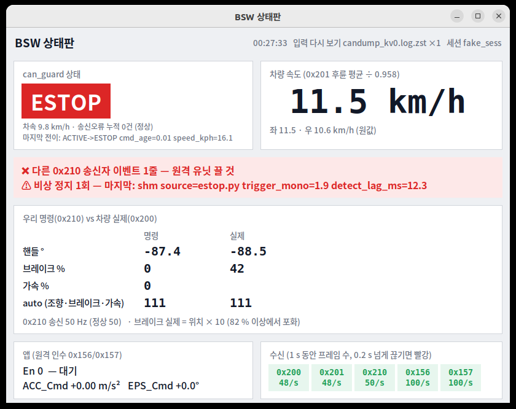

# tools/bsw — BSW 한 번에 켜기·끄기 (경주·자율 주행용)

11-04 자율 주행 때는 Kvaser 미러, can_guard(sudo·RT), 브리지, 어댑터, arm 서비스 2개, candump 를 **하나씩** 띄웠다.
그래서 순서와 옵션이 자주 엇갈렸다(RT 실패 → `--no-rt`, 원격 유닛이 켜진 채 시작, 녹화 누락 등).
이 폴더의 명령 셋이면 "모델이 `/control/target` 을 내면 바로 움직이는" 상태가 만들어지고, **CAN 로그는 자동으로 녹화**된다.
ROS bag 은 다른 팀이 따므로 여기서는 녹화하지 않는다.

```bash
bash tools/bsw/bsw_up.sh --name LAP1      # 켜기 (sudo 비밀번호 1회) — 끝나면 상태판 창이 자동으로 뜬다
bash tools/bsw/bsw_up.sh --name RACE --no-ui   # 대회 본 주행처럼 화면 볼 사람이 없으면 상태판 없이
bash tools/bsw/bsw_down.sh                 # 끄기 (차가 선 뒤) — 상태판 창도 같이 닫힌다
```

| 파일 | 무엇 | 언제 |
|---|---|---|
| `bsw_up.sh` | 전부 켜기 + 상태판 창 | 주행 시작 |
| `bsw_down.sh` | 정지 확인 → ESTOP → 정리 → CAN 로그 압축 | 주행 끝 |
| `race_up_check.py` | 시작 점검: `/race/state` 발행, 0x202 값, 표 버전·source(`bsw_up`·`bsw_status` 가 부름, 읽기만) | 자동 |
| `bsw_monitor.py` | **상태판 창(실시간 UI)** — 속도·명령 vs 실제·앱·수신·can_guard 상태·경기 신호(표시만)·경고 | 연습 주행 내내(자동으로 뜸) |
| `bsw_status.sh` | **점검표(한 번 출력)** — 프로세스가 살았나, RT 인가, 녹화되나 | `bsw_up` 끝에 자동 1회, 이상할 때 |
| `bsw.env` | 기본값 | — |

## 켜면 무엇이 뜨나 (`bsw_up.sh` → `tools/track_day/bringup.sh`, 현장 시험과 같은 코드)

| 순서 | 구성 | 확인 |
|---|---|---|
| 1 | Kvaser Leaf ch0 → `kv0` 미러 + **원본 CAN 로그** `kvaser_ch0.log` | 0x200/0x201 수신 |
| 2 | `can_guard` — CPU 8·SCHED_FIFO 90, 앱(0x156/0x157) 필수, 한계 조향 150°·브레이크 100 %·가속 `BSW_ACC_LIMIT` | 커널에서 SCHED_FIFO·CPU 직접 확인(✅/⚠️). 다른 0x210 송신자가 있으면 시작 거부 |
| 3 | 상태 브리지(0x200/0x201/0x210 → `/control/status/*`) + 어댑터(`auto_arm:=true`) | `/control/adapter/status` |
| 4 | `candump -L kv0` → `candump_kv0.log` (ROS bag 없음) | 파일 크기 증가 |
| 5 | `SESSION.md` — 시작 시각·커밋·한계·옵션(results.md 에 옮길 값) | — |
| 6 | 상태판 창 `bsw_monitor.py`(nice 10, 읽기 전용) — `--no-ui` 면 생략, 화면 없으면(ssh) 생략하고 `--text` 안내 | 창이 뜸 |

세션 폴더는 `~/a1_race_capture/<날짜_시각>_BSW-<이름>/` 이고, 최신 세션은 `~/a1_race_capture/bsw_latest` 링크로 찾는다.

## 자동 arm 규칙 (어댑터 `auto_arm`)

- 모델 입력이 **0.3 s 동안 계속 신선**하고, can_guard 공유메모리와 0x200 조향 위치가 있으면 조향·종방향을 **한 번** 자동으로 arm 한다.
- 한 번뿐이다. 운영자가 disarm 하거나 **고장 래치**(입력이 150 ms 끊김, NaN·범위 밖 값)가 나면 다시 자동으로 올라가지 않는다.
  다시 가려면 `bsw_down` → `bsw_up` 하거나, 원인을 확인한 뒤 arm 서비스를 부른다.
- **모델 팀 약속:** 서 있을 때도 정지 목표(예: `accel_mps2 = −3`)를 계속 발행한다. 끊기면 래치 → 브레이크(HOLDING) → 2 s 뒤 STOPPED 로 간다.
- `bsw_up` 시작 때 `/control/target` 이 이미 발행 중이면 경고하고 확인을 받는다(뜨자마자 움직일 수 있음).
- 자동 arm 을 원하지 않으면 `--manual-arm` 을 쓴다(예전처럼 `ros2 service call /control/adapter/arm_steer|arm_long`).

## 상태판 창 (`bsw_monitor.py`, 2026-11-06 창 UI 로 변경)

연습 주행 때 봐야 할 수치를 창 하나에 모은다(Python 표준 라이브러리 + tkinter, 5 Hz 갱신, 바뀐 칸만 다시 그림).
`bsw_up` 이 자동으로 띄우고 `bsw_down` 이 닫는다. 창을 닫아도 주행에는 영향이 없다.



| 칸 | 내용 | 빨강·노랑이 되는 때 |
|---|---|---|
| can_guard 상태 | INIT(회색)·ACTIVE(초록)·HOLDING(노랑)·STOPPED(주황)·ESTOP(빨강). 이벤트 로그의 상태 전이로 **바로** 바뀐다. 아래에 차속·송신오류·마지막 전이 | — |
| 차량 속도 | 0x201 후륜 평균 ÷ 0.958 (좌·우 원값) | 0x201 없음 |
| 경고 줄 | 아래 경고를 모아서. 없으면 초록 "경고 없음" | 앱 En = 1, 0x210 > 75 Hz(송신자 둘), `foreign_0x210`, 비상 정지 횟수, 0x156 없음, 우리 0x210 없음 |
| 명령 vs 실제 | 핸들 °, 브레이크 %(실제 = 위치 × 10), 가속 %, auto 비트 — 왼쪽 0x210, 오른쪽 0x200 | 0x210 송신율 75 Hz 초과 |
| 앱 | En, ACC_Cmd, EPS_Cmd | En = 1 "앱이 쥠: 차량은 0x210 무시" |
| 수신 | ID 별 1 s 프레임 수(0x200·0x201 48, 0x210 50, 0x156·0x157 100 이 정상) | 0.2 s 넘게 안 옴 |

```bash
python3 tools/bsw/bsw_monitor.py                          # 직접 띄우기(kv0 + 최신 세션)
python3 tools/bsw/bsw_monitor.py --text                   # 창을 못 띄울 때(ssh) — 터미널 글자 화면
python3 tools/bsw/bsw_monitor.py --replay <CAN 로그.zst>  # 녹화 다시 보기(복기·시험)
```
tkinter 가 없으면 자동으로 글자 화면이 된다(설치: `sudo apt install python3-tk`).

### 성능 영향 — 없다고 판단 (2026-11-06 측정, 개발 PC = 참고)

| 항목 | 값 | 근거 |
|---|---|---|
| 상태판 CPU | **1.8 %**(1코어 기준), 메모리 53 MB | 11-04 auto_bsw4 다시 보기 1× 30 s 평균. 다시 보기는 글자 로그를 파싱하므로 실시간(소켓)보다 무겁다 = 상한 |
| 화면 서버 증가분 | Xwayland +0.7 %, gnome-shell +0.25 % | 상태판 있음/없음 20 s 비교 |
| 20 ms 주기 루프 늦음(can_guard 와 같은 주기, **격리·RT 없이**) | p99 0.18 → 0.28 ms, 최대 0.49 → 0.42 ms, 5 ms 넘은 주기 0 / 1500 | 같은 PC 에서 상태판 없음/있음 30 s씩 |
| 글자 화면 CPU | 1.4 %, 26 MB | 비교용 |

대회 PC 에서는 이보다 더 안전하다.
- can_guard 는 **격리 코어 8 · SCHED_FIFO 90** 이다. 부팅 때 `isolcpus=8-15` 라 상태판 같은 일반 프로세스는 그 코어에 아예 못 간다. 게다가 상태판은 `nice 10` 으로 뜬다.
- 상태판은 **Kvaser 채널을 열지 않는다.** 미러가 만든 `kv0` 사본만 읽고, 커널 필터로 5개 ID 만 받는다.
  상태판이 멈추면 vcan 은 이 소켓 몫만 버린다. 미러·candump·can_guard 는 기다리지 않는다.
  Kvaser 핸들이 하나 더 생기면 11-03 처럼 송신이 깨질 수 있어서 이렇게 했다(보고서 5장).
- 남는 경합은 비격리 코어 0–7 에서 모델·ROS 노드와 CPU 를 나눠 쓰는 것뿐이고, 그 크기는 약 3 %·1코어다.
- 그래도 **대회 본 주행**처럼 볼 사람이 없으면 `--no-ui` 로 끈다. 영향이 없어서라기보다 필요가 없어서다.

## disarm 은 정지가 아니다 (중요, 2026-11-05)

| 언제 disarm | can_guard | 차량 |
|---|---|---|
| 정상 주행 중(ARMED) | ACTIVE 인 채 **0x210 송신을 멈춤**(auto 000 을 보내지는 않음) | 0x210 끊김 동작 = 미확정(TODO-2). **우리 브레이크 없음** |
| 고장 래치 뒤(HOLDING 중) | 2026-11-05 수정: 어댑터가 can_guard 재시작 전까지 쓰지 않음 → HOLDING → STOPPED 유지 | 브레이크 30 → 60 % 유지 |
| STOPPED·ESTOP 중 | 2026-11-05 수정: 마지막 auto 비트로 브레이크를 계속 보냄 | 브레이크 유지 |

→ **주행 중에는 disarm 대신 `estop.py`(또는 앱)를 쓴다.** 끝낼 때는 `bsw_down`(ESTOP → 종료, disarm 안 함)을 쓴다.

## 끄기 (`bsw_down.sh`)

1. can_guard 상태 줄의 차속이 `BSW_STOP_KPH`(1 km/h)를 넘으면 **끄지 않는다**(`--force` 로 무시).
2. `estop.py` 로 ESTOP 을 건다. 가속 0, 브레이크 30 → 82 %, **auto 비트 유지**. disarm 은 하지 않는다 — auto 000 은 페일세이프 브레이크를 풀기 때문이다(CLAUDE.md 1.4).
3. `stop.sh --no-disarm` 으로 노드·can_guard·녹화를 정리한다.
4. CAN 로그(`kvaser_ch0.log`, `candump_kv0.log`, `can_guard_events.csv`)를 zstd 로 압축하고 `can_logs.sha256` 을 만든다. 00 분석 요약(비상 정지·두 송신자)도 출력한다.

0x210 이 끊긴 뒤 차량이 어떻게 동작하는지는 아직 확정되지 않았다(TODO-2). 그래서 **바퀴를 괴고 사람이 대기한 뒤** 끈다.

## 옵션·기본값

기본값은 [`bsw.env`](bsw.env) 에 있다. 현장에서 바꿀 때는 파일을 고치지 말고 명령줄 옵션을 쓴다(그래야 `SESSION.md` 에 남는다).

| 옵션 | 뜻 |
|---|---|
| `--name RUN` | 세션 이름(영문·숫자·`._-`) |
| `--sil` / `--peak [can0]` | 차량 없이 vcan0 + 가짜 차량(리허설) / PEAK 카드 |
| `--manual-arm` | 자동 arm 끔 |
| `--no-ui` | 상태판 창을 띄우지 않음(대회 본 주행) |
| `--no-app` | 앱 없이 시작(물리 E-stop 담당이 있을 때만) |
| `--no-rt` | 비격리 실행(지연 값은 '비격리'로 표기) |
| `--acc-limit P`, `--params YAML`, `--yes` | can_guard 가속 한계, 어댑터 표, 확인 질문 생략 |

## 확인 상태 (2026-11-05)

| 항목 | 결과 |
|---|---|
| 어댑터 auto_arm (개발 PC, ROS2 Humble, can_guard virtual 버스) | 입력 0.30 s 뒤 자동 arm → 입력 끊김 151 ms 에 래치 → disarm 뒤 새 입력이 와도 다시 arm 안 됨 ✅ |
| `bsw_down` (가짜 세션 폴더) | 12.3 km/h 이면 거부, 0.0 km/h 이면 ESTOP → 정리 → 압축·sha256 → 00 분석 ✅ |
| 상태판 창 (개발 PC, 11-04 auto_bsw4 다시 보기 + 가짜 세션) | 정상 화면·ESTOP·경고 2개 표시 확인, 성능은 위 표 ✅ |
| `bsw_up` 전체 | **대회 PC 에서 `bash tools/bsw/bsw_up.sh --sil` 로 확인 필요**(vcan·sudo, 상태판 창이 뜨는지 포함). 그다음 실차 |
